# МІНІСТЕРСТВО ОСВІТИ І НАУКИ УКРАЇНИ
# НАЦІОНАЛЬНИЙ УНІВЕРСИТЕТ «ОДЕСЬКА ПОЛІТЕХНІКА»
**Навчально–науковий інститут комп’ютерних систем**
**Кафедра інженерії програмного забезпечення**

---

### Тимур БЕРЕЖНИЙ
#### (група АС-213м)

---

# КВАЛІФІКАЦІЙНА РОБОТА МАГІСТРА
## Програмне забезпечення адаптивної музичної системи з елементами штучного інтелекту для рольових ігор

**Спеціальність:** 121 Інженерія програмного забезпечення
**Освітньо–професійна програма:** Інженерія програмного забезпечення
**Керівник:** Марія ПОПОВА, к.е.н., доцент

---

**Одеса – 2026**

---

## АНОТАЦІЯ

Бережний Т. В. Програмне забезпечення адаптивної музичної системи з елементами штучного інтелекту для рольових ігор : кваліфікаційна робота магістра за спеціальністю «121 Інженерія програмного забезпечення» / Тимур Важович Бережний ; керівник Марія Олександрівна Попова. – Одеса : Нац. ун–т «Одес. політехніка», 2026. – 82 с.

Кваліфікаційна робота містить основну текстову частину на 66 сторінках, список використаних джерел з 15 найменувань на 2 сторінках, додатки на 14 сторінках.

Як результат роботи виконано аналіз та створено програмну систему для адаптивного музичного супроводу настільних рольових ігор з використанням штучного інтелекту для аналізу емоційного контексту та настрою гравців на основі їхніх голосових комунікацій у реальному часі. У роботі застосовано методологію дизайн-мислення для дослідження потреб користувачів, здійснено порівняльний аналіз існуючих аналогів, сформульовано специфікацію вимог, виконано порівняння та обґрунтування двох архітектур-кандидатів системи, спроєктовано реляційну базу даних, розроблено програмні класи та створено інтерфейс користувача у стилістика Dark Fantasy.

**Ключові слова:** адаптивна музика, штучний інтелект, настільні рольові ігри, розпізнавання мовлення, аналіз настрою, дизайн-мислення, гібридна архітектура, JavaScript, React, Python, FastAPI, Whisper, Groq API.

---

## ABSTRACT

Berezhnyi T. V. Software for adaptive music system with elements of artificial intelligence for role-playing games: master's thesis in the specialty «121 Software Engineering» / Tymur Vazhovych Berezhnyi ; supervisor Mariia Oleksandrivna Popova. – Odesa: Odesa Polytech Nat. Univ., 2026. – 82 p.

The qualification work contains the main text part on 66 pages, a list of used sources with 15 titles on 2 pages, appendices on 14 pages.

As a result of the work, an analysis was performed and a software system was created for adaptive musical accompaniment of tabletop role-playing games using artificial intelligence to analyze the emotional context and player mood based on their real-time voice communications. The Design Thinking methodology was applied to analyze user needs, a comparative analysis of existing software solutions was conducted, system requirements specifications were formulated, two architecture candidates were evaluated and justified, a relational database was designed, software classes were developed, and a fantasy-themed user interface was created.

**Keywords:** adaptive music, artificial intelligence, tabletop role-playing games, speech recognition, mood analysis, design thinking, hybrid architecture, JavaScript, React, Python, FastAPI, Whisper, Groq API.

---

## ЗМІСТ

- Вступ
- 1 Інформаційна модель
  - 1.1 Аналіз проблем користувачів та варіантів засобів для розв'язання (на основі підходу дизайн-мислення)
  - 1.2 Порівняльний аналіз існуючих рішень та виявлення прогалин
  - 1.3 Опис вхідних і вихідних даних та алгоритму розв’язання задачі
  - Висновки до розділу 1
- 2 Специфікація вимог до системи
  - 2.1 Загальні характеристики та актори системи
  - 2.2 Функціональні вимоги
  - 2.3 Вимоги до якості, безпеки, інтерфейсів та нефункціональні вимоги
  - Висновки до розділу 2
- 3 Проєктування архітектури системи
  - 3.1 Опис та порівняльний аналіз архітектур-кандидатів системи
  - 3.2 Обґрунтування вибору архітектурного проєкту
  - 3.3 Проєктування компонентів та модульної структури
  - 3.4 Проєктування бази даних
  - 3.5 Проєктування інтерфейсу користувача
  - Висновки до розділу 3
- 4 Програмна реалізація системи
  - 4.1 Обґрунтування вибору засобів розробки
  - 4.2 Опис програмних класів застосунку
  - Висновки до розділу 4
- 5 Тестування програмної системи
  - Висновки до розділу 5
- 6 Експериментальна перевірка досягнення мети розробки
  - 6.1 Інтерфейс користувача
  - 6.2 Контрольний приклад
  - 6.3 Постановка та аналіз експерименту
  - Висновки до розділу 6
- Загальні висновки
- Список використаних джерел
- Додаток А Код програми

---

## ПЕРЕЛІК ІЛЮСТРАЦІЙ ТА ТАБЛИЦЬ

| № | Назва рисунку / таблиці |
| --- | --- |
| Таблиця 1.1 | Порівняльний аналіз аналогів |
| Рисунок 2.1 | Діаграма варіантів використання |
| Таблиця 3.1 | Порівняльний аналіз архітектур-кандидатів системи |
| Рисунок 3.1 | Архітектура гібридної системи Adaptive OST |
| Рисунок 3.2 | Схема розподілу модулів Frontend та Backend |
| Рисунок 3.3 | Діаграма послідовності виконання агентного циклу |
| Рисунок 3.4 | Діаграма потоку даних (DFD) |
| Рисунок 3.5 | Діаграма ER-моделі бази даних |
| Таблиця 3.2 | Структура таблиці users |
| Таблиця 3.3 | Структура таблиці user_preferences |
| Таблиця 3.4 | Структура таблиці session_history |
| Таблиця 3.5 | Структура таблиці mood_logs |
| Рисунок 3.6 | Макет сторінки авторизації |
| Рисунок 3.7 | Макет головної сторінки системи |
| Рисунок 3.8 | Діаграма переходів між екранами |
| Рисунок 4.1 | Стек технологій системи |
| Рисунок 4.2 | Діаграма класів системи |
| Рисунок 4.3 | Діаграма станів агентного циклу |
| Рисунок 6.1 | Результати відповідей на питання "Чи зручно було використовувати систему?" |
| Рисунок 6.2 | Результати відповідей на питання "Чи точно система визначала настрій гри?" |
| Рисунок 6.3 | Результати відповідей на питання "Чи покращила система атмосферу гри?" |
| Рисунок 6.4 | Результати відповідей на питання "Чи порекомендували б ви систему?" |
| Рисунок 6.5 | Зведена діаграма результатів опитування |

---

## ВСТУП

**Актуальність теми роботи.** Ігрова індустрія та галузь цифрових розваг продовжують стрімко розвиватися, де важливу роль відіграють настільні рольові ігри (НРІ), такі як Dungeons & Dragons, Pathfinder, Call of Cthulhu тощо. Аудіосупровід у настільних рольових іграх є ключовим інструментом для створення емоційної атмосфери, підтримання саспенсу та глибокого занурення (immersion) учасників у вигаданий світ.

Традиційний підхід до музичного оформелення ігрових сесій передбачає вручну керований добір саундтреків ведучим гри (Game Master / DM). Ведучий змушений шукати потрібні аудіодоріжки у сторонніх програмах (Spotify, YouTube, Syrinscape), перемикати фонову музику під час раптових сюжетних поворотів (наприклад, перехід від спокійної розмови в таверні до несподіваного нападу монстрів або виявлення секретної пастки). Такий процес спричиняє високе когнітивне перевантаження ведучого, відволікає його від проведення розповіді та руйнує емоційний контур гри.

Інтеграція сучасних технологій штучного інтелекту (ШІ), зокрема локального розпізнавання мовлення у реальному часі та обробки природної мови (NLP / LLM), відкриває нові можливості для створення пасивного, повністю автоматизованого та адаптивного музичного середовища (Adaptive OST). Системний фоновий аналіз голосових комунікацій дозволяє автоматично коригувати музичний супровід відповідно до висловлених емоцій, дій та сюжетного контексту без жодного ручного втручання гравців чи ведучого.

**Мета і задачі роботи.** Метою розробки є створення програмного забезпечення адаптивної музичної системи з елементами штучного інтелекту для настільних рольових ігор, яке автоматично аналізує голосовий потік учасників у реальному часі, визначає емоційний настрій і контекст розповіді та здійснює плавну динамічну зміну музичного супроводу.

Для досягнення поставленої мети необхідно вирішити наступні задачі:
1. Провести аналіз проблем користувачів із застосуванням методології дизайн-мислення (Design Thinking) та порівняльний аналіз існуючих програмних аналогів.
2. Визначити вхідні та вихідні дані системи, а також розробити комплексний алгоритм розв'язання задачі адаптивного керування аудіопотоком.
3. Сформулювати специфікацію функціональних та нефункціональних вимог до програмної системи, включаючи побудову діаграми варіантів використання та опису текстових сценаріїв RUP/IEEE.
4. Розробити та порівняти архітектурні альтернативи (архітектури-кандидати), обґрунтувати вибір гібридної клієнт-серверної архітектури з edge-транскрипцією.
5. Спроєктувати реляційну базу даних, модульну структуру застосунку, діаграми послідовності (Sequence Diagram), діаграми потоку даних (DFD) та макети користувацького інтерфейсу у стилістика Dark Fantasy.
6. Здійснити програмну реалізацію вебзастосунку на базі фреймворків React та FastAPI з інтеграцією локальної нейромережі Whisper.js та сервісу Groq API (Llama 3.1).
7. Провести функціональне тестування та експериментальне опитування користувачів для оцінки ефективності розробленого програмного забезпечення.

**Об'єкт роботи.** Процес розробки адаптивних музичних систем з використанням засобів штучного інтелекту для аналізу контексту та настрою у реальному часі.

**Предмет роботи.** Програмне забезпечення адаптивної музичної системи для рольових ігор з елементами штучного інтелекту для розпізнавання мовлення, оцінки емоційного стану та автоматичного відтворення саундтреків.

**Модель розробки програмного забезпечення.** У якості моделі життєвого циклу розробки було обрано ітеративну (гнучку) модель Agile/Scrum. Це зумовлено необхідністю постійного експериментального підтвердження якості розпізнавання мовлення в браузері, оптимізації затримок аналізу настрою через API та оперативного коригування параметрів Web Audio API на основі фідбеку під час пробних ігрових сесій.

**Практична значущість** результатів полягає у створенні працюючого кросплатформеного вебзастосунку, який усуває когнітивне навантаження на ведучого рольової гри, забезпечує високий рівень приватності завдяки локальному перетворенню голосу в текст та підвищує якість імерсивного досвіду учасників настільних рольових ігор.

---

## 1 ІНФОРМАЦІЙНА МОДЕЛЬ

### 1.1 Аналіз проблем користувачів та варіантів засобів для розв'язання (на основі підходу дизайн-мислення)

Під час підготовки проєкту ми використали підхід дизайн-мислення (Design Thinking) для глибокого розуміння реальних потреб і проблем користувачів — ведучих настільних рольових ігор (Game Master / DM) та гравців. Дизайн-мислення передбачає п’ять послідовних етапів: Емпатія (Empathize), Визначення (Define), Генерація ідей (Ideate), Прототипування (Prototype) та Тестування (Test).

На етапі **Емпатії** було проведено серію спостережень та опитувань серед 15 ведучих НРІ різного рівня досвіду. У ході дослідження ми з'ясували, як саме організований процес керування аудіосупроводом під час ігрової сесії.

На етапі **Визначення** ми сформулювали ключові проблеми користувачів:
1. **Когнітивне перевантаження ведучого гри.** Ведучий повинен одночасно відстежувати правила гри, контролювати поведінку декількох персонажів, описувати оточення та імпровізувати. Необхідність паралельно шукати відповідний трек у Spotify чи Syrinscape викликає серйозний стрес та втому.
2. **Розрив емоційного занурення (Break of Immersion).** Коли у грі стається несподіваний сюжетний поворот (наприклад, раптовий напад із засідки), ведучому потрібно від 10 до 30 секунд, щоб знайти та увімкнути бойову музику. Ця пауза повністю руйнує накопичену напругу та динаміку сцени.
3. **Неточність статичних плейлистів.** Стандартні фонові аудіодоріжки не реагують на тонкі зміни в інтонації або змісті розмови гравців. Вони грають циклічно та часто не відповідають миттєвому настрою сесії.

На етапі **Генерації ідей** ми сформулювали концепцію системи, яка працює у режимі «пасивного слухача». Замість того, щоб вимагати від ведучого натискання кнопок або вибору категорій, система повинна неперервно захоплювати голосовий потік через мікрофон, локально перетворювати мовлення на текст, оцінювати емоційний контекст за допомогою ШІ та самостійно плавно коригувати саундтрек.

На етапі **Прототипування** було спроєктовано базовий потік обробки даних від мікрофона до Web Audio API програвача, а на етапі **Тестування** сформовано гіпотези щодо швидкодії та точності визначення настрою, які були перевірені під час розробки.

### 1.2 Порівняльний аналіз існуючих рішень та виявлення прогалин

Для оцінки ринку та обґрунтування доцільності розробки нашої системи ми провели порівняльний аналіз існуючих програмних продуктів, які використовуються для аудіосупроводу настільних рольових ігор.

Ми розглянули такі існуючі рішення:
- **Spotify / Apple Music** — загальновживані музичні стрімінгові сервіси. Користувачі створюють або шукають готові плейлисти (наприклад, «D&D Battle», «Tavern Ambience»).
- **Syrinscape** — спеціалізований програмний комплекс для створення звукових ефектів та атмосферної музики у настільних іграх. Містить деталізовані саундсети.
- **Tabletop Audio** — популярний вебсервіс із набором 10-хвилинних фонових аудіотреків та панеллю soundpad для додавання поодиноких звукових ефектів.
- **Foundry VTT Audio Modules** — вбудовані аудіомодулі для віртуальних ігрових столів, які дозволяють прив'язувати треки до конкретних карт або ігрових подій.

Порівняння нашої розроблюваної системи з аналогами за основними функціональними характеристиками наведено в таблиці 1.1.

Таблиця 1.1 – Порівняльний аналіз аналогів

| Функціональна характеристика | Spotify / Apple Music | Syrinscape | Tabletop Audio | Foundry VTT Modules | Наша система (Adaptive OST) |
| --- | --- | --- | --- | --- | --- |
| Відтворення тематичної музики | Підтримує | Підтримує | Підтримує | Підтримує | Підтримує |
| Потрібне ручне керування треками | Так (повністю) | Так (частково) | Так (повністю) | Так (через тригери) | Ні (автоматично) |
| Розпізнавання мовлення в реальному часі | Не підтримує | Не підтримує | Не підтримує | Не підтримує | Підтримує |
| ШІ-аналіз контексту та настрою тексту | Не підтримує | Не підтримує | Не підтримує | Не підтримує | Підтримує |
| Плаваючий кросфейд між настроями | Ручний | Автоматичний | Відсутній | Автоматичний | Автоматичний інтелектуальний |
| Локальна обробка голосу (Приватність) | Н/Д | Н/Д | Н/Д | Н/Д | Підтримує (Whisper.js) |
| Фентезійний стилізований UI | Не підтримує | Підтримує | Підтримує | Підтримує | Підтримує |

Проведений порівняльний аналіз дозволяє чітко виявити **прогалину в покритті потреб користувачів**: жодне з наявних рішень не надає можливості пасивного автоматичного підбору та зміни музики на основі нейромережевого аналізу контексту природного мовлення в реальному часі. Наша система заповнює цю прогалину, вивільняючи увагу ведучого для ігрового процесу.

### 1.3 Опис вхідних і вихідних даних та алгоритму розв’язання задачі

На основі виконаного аналізу ми визначили чіткий перелік вхідних і вихідних даних, а також розробили алгоритм функціонування адаптивної музичної системи.

**Вхідні дані системи:**
1. **Аудіосигнал з мікрофона:** безперервний потік PCM-аудіоданих у форматі Float32 з частотою дискретизації 16000 Гц, який захоплюється з мікрофона ведучого або гравців за допомогою Web Audio API.
2. **Конфігураційні параметри сесії:** обрані користувачем налаштування чутливості мікрофона (audio sensitivity), базовий пресет середовища за замовчуванням (default environment: tavern, dungeon, forest тощо), бажана тривалість аудіочанка (за замовчуванням 5 секунд).
3. **Облікові дані користувача:** email та хешований пароль для авторизації та завантаження персональних налаштувань.

**Вихідні дані системи:**
1. **Текстова транскрипція:** розпізнаний фрагмент мовлення у вигляді текстового рядка UTF-8.
2. **Структурований вектор настрою ($M$):** JSON-об'єкт, що містить поля:
   - `mood` — емоційний стан із фіксованого множини: `calm` (спокій), `tense` (напруга), `battle` (бій), `mystery` (таємниця), `celebration` (святкування), `sad` (смуток);
   - `intensity` — числова шкала інтенсивності від 1 до 10;
   - `environment` — виявлене середовище (`tavern`, `dungeon`, `forest`, `castle`, `wilderness`, `town`);
   - `reasoning` — коротке текстове пояснення ШІ щодо прийнятого рішення.
3. **Аудіопотік музичного супроводу:** динамічно змішаний звуковий сигнал саундтреку, що виводиться на пристрій відтворення користувача з застосуванням плавного кросфейду (crossfade) та нормалізації гучності.

**Алгоритм розв’язання задачі:**
Загальний алгоритм роботи системи складається з наступних кроків:
- *Крок 1.* Ініціалізація аудіоконтексту та завантаження моделей (Whisper.js у браузері через WebGPU).
- *Крок 2.* Початок захоплення аудіосигналу та нарізка на фіксовані тайм-слоти (по 5 секунд).
- *Крок 3.* Обчислення рівня гучності (RMS). Якщо рівень нижчий порогового значенні (тиша), крок пропускається.
- *Крок 4.* Локальне перетворення аудіофрагмента в текст за допомогою нейромережі Whisper.js.
- *Крок 5.* Відправка розпізнаного тексту через асинхронний REST-запит на FastAPI backend.
- *Крок 6.* Передавання тексту до LLM-моделі (Llama 3.1 via Groq API) з спеціально розробленим prompt-шаблоном для визначення вектора настрою $M$.
- *Крок 7.* Парсинг та валідація отриманої JSON-структури на сервері та повернення клієнту.
- *Крок 8.* Прийняття рішення аудіорушієм (AudioEngine) на клієнті: якщо виявлений настрій `mood` або середовище `environment` відрізняються від поточного, запускається процедура плавної зміни треку (crossfade duration 2.5 секунди).
- *Крок 9.* Оновлення графічного інтерфейсу та занесення запису до історії сесії.

### Висновки до розділу 1

У першому розділі ми провели всебічний аналіз предметної області адаптивних музичних систем для настільних рольових ігор.
Застосування методології дизайн-мислення дозволило чітко сформулювати ключові проблеми користувачів, серед яких головними є когнітивне перевантаження ведучого та розрив емоційного занурення через ручний пошук саундтреків.

Порівняльний аналіз існуючих аналогів (Spotify, Syrinscape, Tabletop Audio тощо) підтвердив наявність виявленої прогалини — відсутність систем з автоматичним фоновим ШІ-аналізом контексту мовлення у реальному часі.

Ми визначили структуру вхідних та вихідних даних і розробили поетапний алгоритм розв'язання задачі, який поєднує локальне розпізнавання мовлення Whisper.js, серверний аналіз настрою за допомогою LLM Llama 3.1 та клієнтське відтворення саундтреків із плавним кросфейдингом.

---

## 2 СПЕЦИФІКАЦІЯ ВИМОГ ДО СИСТЕМИ

### 2.1 Загальні характеристики та актори системи

Система Adaptive OST призначена для забезпечення автоматичного та напівавтоматичного музичного супроводу настільних рольових ігор.
Система функціонує у двох основних режимах:
1. **Автоматичний (пасивний) режим:** система фоново слухає розмову через мікрофон, аналізує настрій та самостійно перемикає музику.
2. **Ручний режим (Manual Override):** користувач має можливість у будь-який момент вручну обрати потрібний настрій або середовище через графічний інтерфейс, заблокувавши автоматичну зміну.

**Актори системи:**
- **Користувач (Ведучий гри / Гравець):** основна дійова особа, яка реєструється в системі, керує запуском та зупинкою сесії, налаштовує мікрофон, переглядає результати ШІ-аналізу та за потреби вручну перевизначає настрій.

### 2.2 Функціональні вимоги

Функціональні вимоги до системи сформовано відповідно до RUP Software Requirements Specification Template та IEEE 830. Вони розбиті на наступні модулі:
- **Підсистема авторизації:** реєстрація нових користувачів, вхід за логіном/паролем, створення JWT-токенів, вихід із системи.
- **Підсистема захоплення аудіо:** вибір пристрою введення, контроль рівня сигналу, нарізка аудіопотоку на фрагменти.
- **Підсистема розпізнавання мовлення:** завантаження та виконання моделі Whisper у браузері, перетворення аудіо в текст.
- **Підсистема ШІ-аналізу настрою:** формування промпта, взаємодія з Groq API, парсинг JSON-відповіді.
- **Підсистема керування відтворенням:** завантаження саундтреків, перемикання треків, плавний кросфейд (crossfade), керування гучністю.
- **Підсистема інтерфейсу:** відображення поточного настрою, інтенсивності, середовища, транскрипції та візуалізації звуку.

На рисунку 2.1 представлена діаграма варіантів використання системи.

**Рисунок 2.1 – Діаграма варіантів використання**

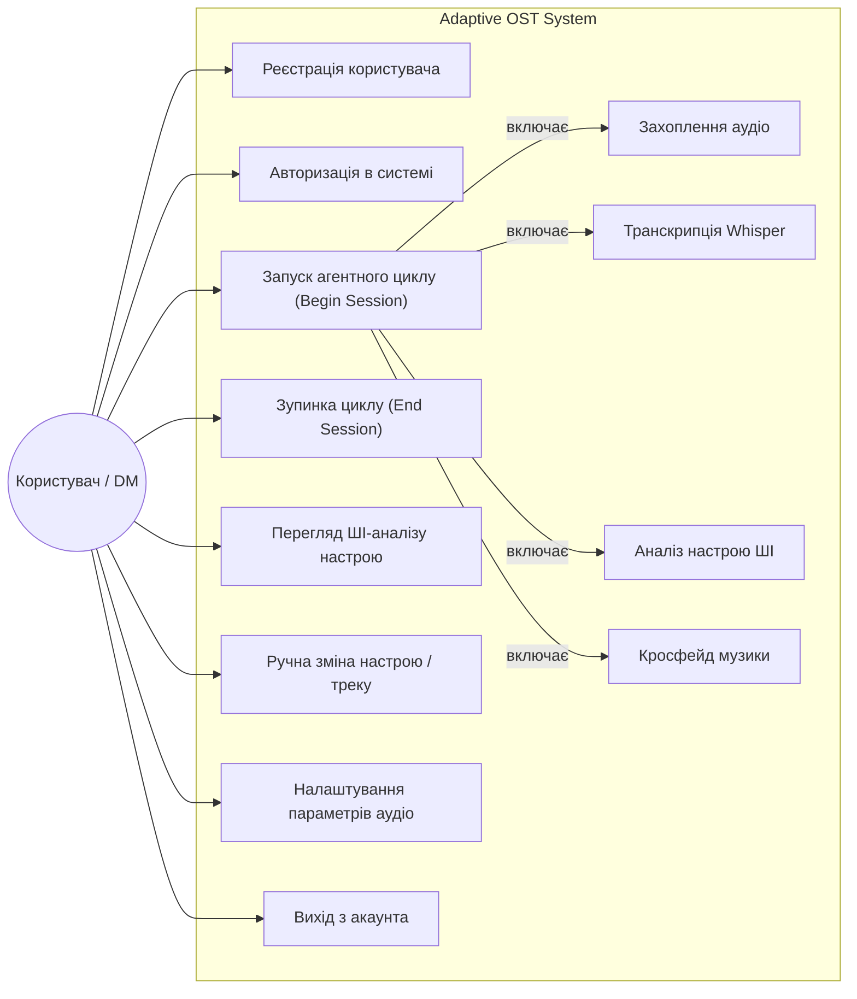

Наведемо деталізовані текстові сценарії для основних варіантів використання системи.

---

**Сценарій 2.1 ‒ Реєстрація користувача та створення облікового запису**

**Основна дійова особа:** новий користувач.
**Область дії:** підсистема авторизації користувачів.
**Передумови:** користувач знаходиться на сторінці входу в застосунок.
**Результати (постумови):** створено обліковий запис у базі даних, згенеровано JWT-токен, здійснено автоматичний вхід на головну панель.
**Тригер:** бажання користувача створити новий акаунт.
**Основний успішний сценарій:**
1. Користувач відкриває сторінку авторизації застосунку.
2. Натискає посилання «Create Account».
3. Вводить електронну пошту, ім'я користувача (username) та пароль.
4. Натискає кнопку «Begin Your Quest».
5. Система перевіряє унікальність email, хешує пароль за допомогою bcrypt, зберігає користувача в SQLite БД.
6. Система генерує JWT-токен та авторизує користувача, перенаправляючи його на головний екран.

**Розширення (альтернативні сценарії):**
3а. Користувач вводить некоректний email або пароль довжиною менше 6 символів.
3а.1. Система виводить повідомлення про помилку під відповідним полем і блокує відправку форми до виправлення.
3б. Користувач вводить email, який вже зареєстрований у системі.
3б.1. Система повертає помилку 400 Bad Request з повідомленням «Email already registered».

---

**Сценарій 2.2 ‒ Авторизація користувача (вхід у систему)**

**Основна дійова особа:** зареєстрований користувач.
**Область дії:** підсистема авторизації користувачів.
**Передумови:** користувач має створений акаунт і знаходиться на сторінці входу.
**Результати (постумови):** успішна автентифікація користувача, збереження токена у LocalStorage.
**Тригер:** бажання користувача увійти у свій акаунт.
**Основний успішний сценарій:**
1. Користувач відкриває сторінку авторизації.
2. Вводить заповнені email та пароль.
3. Натискає кнопку «Enter the Realm».
4. Система отримує запит, знаходить користувача в БД, перевіряє хеш пароля.
5. При успішній перевірці система повертає bearer токен та перенаправляє на головну сторінку.

**Розширення (альтернативні сценарії):**
4а. Користувач вводить невірний пароль або незареєстрований email.
4а.1. Система повертає помилку 401 Unauthorized та виводить повідомлення «Invalid credentials».

---

**Сценарій 2.3 ‒ Запуск та виконання адаптивного агентного циклу**

**Основна дійова особа:** авторизований користувач (DM / Гравець).
**Область дії:** підсистема захоплення аудіо, аналізу та програвання.
**Передумови:** користувач авторизований і перебуває на головній панелі управління.
**Результати (постумови):** система неперервно обробляє голосовий потік та плавно змінює саундтреки у реальному часі.
**Тригер:** натискання кнопки «Begin Session».
**Основний успішний сценарій:**
1. Користувач натискає центральну кнопку «Begin Session».
2. Застосунок запитує дозвіл на доступ до мікрофона у браузері.
3. Користувач надає дозвіл.
4. Система запускає завантаження та ініціалізацію локальної нейромережі Whisper.js у браузері.
5. Запускається аудіорушій (AudioEngine) та починає грати фоновий саундтрек за замовчуванням (calm/tavern).
6. Кожні 5 секунд система бере накопичений аудіофрагмент, здійснює транскрибування мовлення в текст.
7. Текст надсилається на backend ендпоінт `/api/analyze-mood`.
8. Backend звертається до Groq API (Llama 3.1) та повертає вектор настрою (наприклад, `mood: battle, intensity: 8`).
9. AudioEngine порівнює новий настрій з поточним і виконує плавний 2.5-секундний кросфейд на бойову музичну тему.

**Розширення (альтернативні сценарії):**
3а. Користувач відхиляє доступ до мікрофона.
3а.1. Система відображає модальне повідомлення «Microphone access required» і зупиняє запуск.
6а. Розпізнаний фрагмент містить тишу або занадто короткий текст (<3 символів).
6а.1. Система пропускає відправку запиту до ШІ та продовжує грати поточний саундтрек.

---

**Сценарій 2.4 ‒ Відображення та перегляд результатів ШІ-аналізу настрою**

**Основна дійова особа:** авторизований користувач.
**Область дії:** підсистема відображення даних та UI.
**Передумови:** агентний цикл активний.
**Результати (постумови):** користувач бачить оновлені індикатори настрою, інтенсивності, середовища та розпізнаний текст.
**Тригер:** отримання відповіді від ендпоінта аналізу настрою.
**Основний успішний сценарій:**
1. Система отримує JSON-відповідь від сервера.
2. Головна панель оновлює текстовий індикатор `CURRENT MOOD` (наприклад, CALM, BATTLE, TENSE, MYSTERY).
3. Шкала `Intensity` відображає поточний рівень від 1 до 10.
4. Індикатор `Environment` показує визначене середовище (Tavern, Dungeon тощо).
5. Секція `Last Transcription` відображає останню розпізнану фразу.

---

**Сценарій 2.5 ‒ Ручне перевизначення настрою та вибір пресета**

**Основна дійова особа:** авторизований користувач.
**Область дії:** підсистема аудіопрогравача.
**Передумови:** сесія активна.
**Результати (постумови):** музика негайно перемикається на обраний вручну настрій.
**Тригер:** натискання кнопок ручного вибору настрою на панелі.
**Основний успішний сценарій:**
1. Користувач натискає одну з кнопок ручного перевизначення (наприклад, «Battle» або «Boss Battle»).
2. Система встановлює прапорець ручного блокування (Manual Lock).
3. AudioEngine негайно запускає плавний кросфейд на обраний саундтрек.
4. Автоматичні оновлення від ШІ тимчасово ігноруються до зняття блокування користувачем.

---

**Сценарій 2.6 ‒ Завершення ігрової сесії та збереження статистики**

**Основна дійова особа:** авторизований користувач.
**Область дії:** підсистема управління сесією.
**Передумови:** ігрова сесія активна.
**Результати (постумови):** зупинено захоплення аудіо, вимкнено музику, збережено історію сесії в БД.
**Тригер:** натискання кнопки «End Session».
**Основний успішний сценарій:**
1. Користувач натискає кнопку «End Session».
2. Система зупиняє таймер агентного циклу (setInterval).
3. Відключається запис з мікрофона (MediaRecorder).
4. AudioEngine виконує плавне загасання (fade out) і зупиняє аудіоконтекст.
5. Система надсилає статистику сесії на сервер для збереження в БД.

---

### 2.3 Вимоги до якості, безпеки, інтерфейсів та нефункціональні вимоги

Нефункціональні вимоги визначають критерії якості, продуктивності та безпеки функціонування застосунку.

**Вимоги до інтерфейсів:**
- *Апаратні інтерфейси:* сумісність із персональними комп'ютерами, ноутбуками та планшетами, обладнаними мікрофоном та звуковим пристроєм виведення.
- *Програмні інтерфейси:* сумісність із сучасними веббраузерами з підтримкою Web Audio API та WebGPU/WASM (Google Chrome 113+, Mozilla Firefox 120+, Microsoft Edge 113+, Apple Safari 17+).
- *Інтерфейси зв'язку:* використання захищеного протоколу HTTPS/TLS 1.3 для взаємодії між клієнтом та сервером, формат передачі даних JSON.
- *Інтерфейс користувача:* стилізований фентезійний веб-інтерфейс (Dark Fantasy UI), адаптивний до різних роздільних здатностей екрана.

**Вимоги до продуктивності та швидкодії:**
- Час локальної транскрипції 5-секундного аудіофрагмента моделлю Whisper.js у браузері не повинен перевищувати 1.5 секунди.
- Час відповіді backend ендпоінта аналізу настрою через Groq API не повинен перевищувати 1.0 секунду.
- Загальна затримка реакції системи на зміну сюжету не повинна перевищувати 3.0 секунди від моменту завершення фрази.
- Тривалість плавної зміни музичних треків (crossfade) має становити від 2.0 до 3.0 секунд без клацань та випадань звуку.

**Вимоги до безпеки та конфіденційності:**
- Усі паролі користувачів повинні зберігатися в базі даних виключно у хешованому вигляді із застосуванням криптографічного алгоритму bcrypt (salt factor 12).
- Автентифікація запитів здійснюється за допомогою JWT-токенів із обмеженим терміном дії (24 години).
- **Конфіденційність голосу:** голосові аудіозаписи обробляються локально в оперативній пам'яті браузера користувача і НЕ передаються та НЕ зберігаються на сторонніх серверах. На backend надсилаються лише підготовлені текстові фрагменти.

**Вимоги до надійності та відмовостійкості:**
- Система повинна мати Fallback-механізми: у разі відсутності підтримки WebGPU у браузері користувача розпізнавання мовлення переключається на резервний серверний ендпоінт `/api/transcribe`.
- У разі тимчасової недоступності Groq API система продовжує грати поточний саундтрек без аварійного завершення роботи.

### Висновки до розділу 2

У другому розділі ми сформулювали повну специфікацію функціональних та нефункціональних вимог до адаптивної музичної системи Adaptive OST.
Ми визначили акторів системи та побудували діаграму варіантів використання.
Розроблено 6 деталізованих текстових сценаріїв варіантів використання, що охоплюють реєстрацію, авторизацію, запуск агентного циклу, відображення настрою, ручне перевизначення та завершення сесії.
Сформовано детальні нефункціональні вимоги до продуктивності, безпеки, конфіденційності голосових даних та відмовостійкості системи.

---

## 3 ПРОЄКТУВАННЯ АРХІТЕКТУРИ СИСТЕМИ

### 3.1 Опис та порівняльний аналіз архітектур-кандидатів системи

Під час проєктування програмної системи відповідно до методичних вимог було розглянуто та детально проаналізовано **дві архітектурні альтернативи (архітектури-кандидати)**:

**Архітектура-кандидат 1: Повністю централізована серверна архітектура**
У даній альтернативі клієнтський застосунок виконує лише роль «тонкого клієнта» — захоплює аудіо з мікрофона та неперервно транслює аудіопотік через WebSockets або gRPC на сервер. Вся обробка (розпізнавання мовлення Whisper, аналіз настрою LLM та мікшування аудіо) виконується на потужному сервері.
- *Переваги:* мінімальне навантаження на обчислювальні ресурси пристрою користувача.
- *Недоліки:* величезне навантаження на мережевий канал, висока вартість утримання серверної інфраструктури з відеокартами (GPU), серйозні ризики порушення конфіденційності (передача голосових записів через мережу), висока чутливість до затримок мережі.

**Архітектура-кандидат 2: Гібридна клієнт-серверна архітектура з edge-транскрипцією (Обрана)**
У даній альтернативі розпізнавання мовлення виконується локально на клієнтському пристрої у браузері за допомогою компактної нейромережі Whisper.js (Transformers.js / WebGPU). На сервер FastAPI надсилаються лише розпізнані текстові фрагменти у форматах REST JSON для аналізу настрою через надшвидкісний Groq API (Llama 3.1). Відтворення та кросфейдинг музичних треків виконуються локально через Web Audio API.

Порівняльний аналіз двох архітектур-кандидатів за ключовими інженерними критеріями наведено у таблиці 3.1.

Таблиця 3.1 – Порівняльний аналіз архітектур-кандидатів системи

| Критерій оцінки | Альтернатива 1 (Серверна обробка) | Альтернатива 2 (Гібридна з Edge-Whisper) |
| --- | --- | --- |
| Затримка відгуку (Latency) | Висока (2.5 – 5.0 с) через мережевий трафік | Низька (1.0 – 2.0 с) завдяки Edge-обробці |
| Навантаження на сервер | Дуже високе (потрібні GPU сервери) | Мінімальне (сервер обробляє лише легкий JSON) |
| Витрати на інфраструктуру | Високі ($100+ / місяць) | Низькі (безкоштовні/дешеві інстанси) |
| Конфіденційність голосу | Низька (аудіо передається на сервер) | Абсолютна (аудіо залишається в браузері) |
| Мережевий трафік | Високий (~1.5 Мб/хв на користувача) | Мінімальний (<5 Кб/хв тексту) |
| Вимоги до браузера | Базові | Наявність підтримки Web Audio / WebGPU |

### 3.2 Обґрунтування вибору архітектурного проєкту

На основі порівняльного аналізу ми обрали **Альтернативу 2 (Гібридну клієнт-серверну архітектуру)**. Даний вибір обґрунтовано наступними факторами:
1. **Забезпечення максимальної конфіденційності:** користувачі не бажають, щоб їхні приватні голосові розмови під час ігор передавалися та зберігалися на зовнішніх серверах. Локальна транскрипція повністю вирішує цю проблему.
2. **Масштабованість та економічна ефективність:** оскільки найважча обчислювальна задача (обробка аудіосигналу Float32) перенесена на пристрій користувача, один базовий сервер FastAPI може обслуговувати тисячі одночасних користувачів.
3. **Мінімальні затримки мережі:** передача коротких текстових рядків замість аудіофайлів скорочує час мережевого обміну до 100-200 мс.

На рисунку 3.1 представлена загальна схематична архітектура обраного проєкту.

**Рисунок 3.1 – Архітектура гібридної системи Adaptive OST**

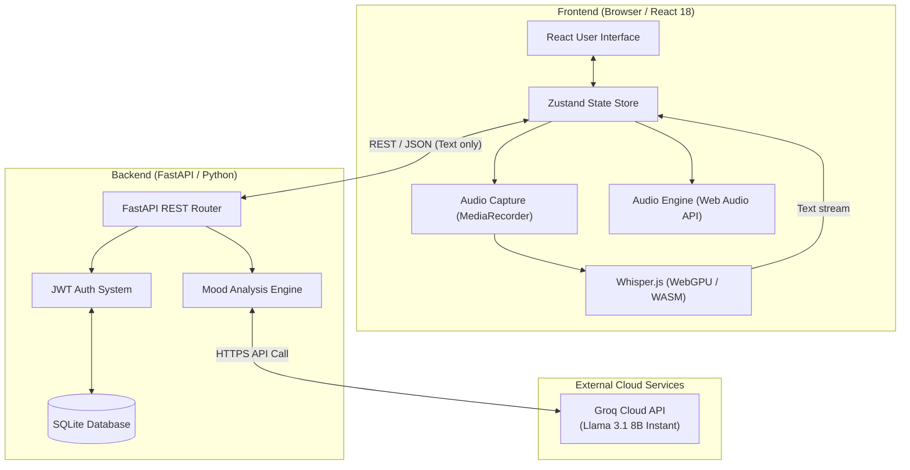

### 3.3 Проєктування компонентів та модульної структури

Модульна структура застосунку розділена на дві незалежні частини: Frontend та Backend.

На рисунку 3.2 зображено схему розподілу модулів у системі.

**Рисунок 3.2 – Схема розподілу модулів Frontend та Backend**

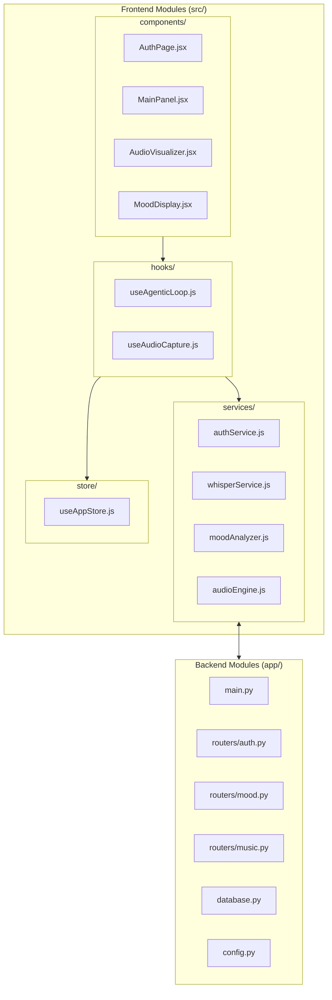

На рисунку 3.3 представлена діаграма послідовності (Sequence Diagram), що описує взаємодію компонентів під час виконання агентного циклу.

**Рисунок 3.3 – Діаграма послідовності виконання агентного циклу**

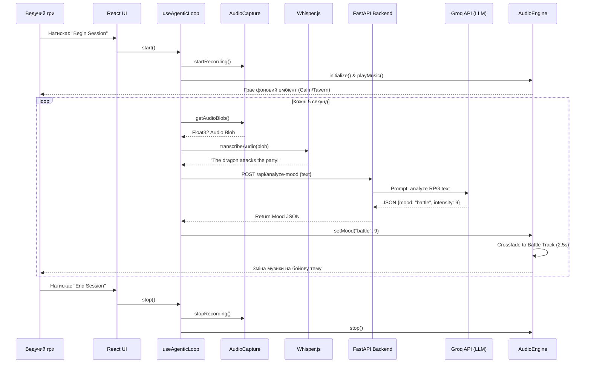

На рисунку 3.4 представлена діаграма потоків даних (DFD).

**Рисунок 3.4 – Діаграма потоку даних (DFD)**

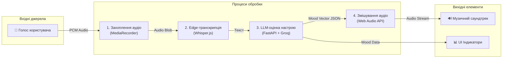

### 3.4 Проєктування бази даних

Для зберігання інформації про користувачів, їхні налаштування та історію ігрових сесій спроєктовано реляційну базу даних SQLite.

На рисунку 3.5 наведено ER-діаграму (Entity-Relationship Diagram) бази даних.

**Рисунок 3.5 – Діаграма ER-моделі бази даних**

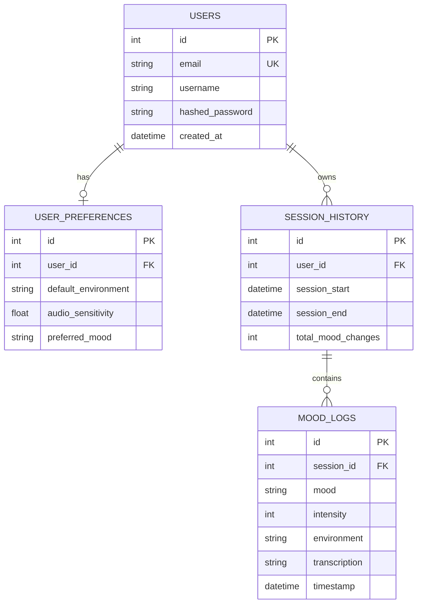

Нижче наведено детальний опис структури таблиць бази даних.

Таблиця 3.2 – Структура таблиці `users`

| Назва поля | Тип даних | Опис | Ключ / Обмеження |
| --- | --- | --- | --- |
| `id` | INTEGER | Унікальний ідентифікатор користувача | Primary Key, AutoIncrement |
| `email` | VARCHAR(255) | Електронна пошта користувача | Unique, Not Null |
| `username` | VARCHAR(100) | Ім'я користувача (нікнейм) | Not Null |
| `hashed_password` | VARCHAR(255) | Хеш пароля (bcrypt) | Not Null |
| `created_at` | DATETIME | Дата та час реєстрації | Default CURRENT_TIMESTAMP |

Таблиця 3.3 – Структура таблиці `user_preferences`

| Назва поля | Тип даних | Опис | Ключ / Обмеження |
| --- | --- | --- | --- |
| `id` | INTEGER | Унікальний ідентифікатор налаштування | Primary Key, AutoIncrement |
| `user_id` | INTEGER | Ідентифікатор користувача | Foreign Key (users.id) |
| `default_environment` | VARCHAR(50) | Пресет середовища за замовчуванням | Default 'tavern' |
| `audio_sensitivity` | FLOAT | Поріг чутливості мікрофона | Default 0.05 |
| `preferred_mood` | VARCHAR(50) | Початковий настрій сесії | Default 'calm' |

Таблиця 3.4 – Структура таблиці `session_history`

| Назва поля | Тип даних | Опис | Ключ / Обмеження |
| --- | --- | --- | --- |
| `id` | INTEGER | Унікальний ідентифікатор сесії | Primary Key, AutoIncrement |
| `user_id` | INTEGER | Ідентифікатор користувача | Foreign Key (users.id) |
| `session_start` | DATETIME | Час початку ігрової сесії | Not Null |
| `session_end` | DATETIME | Час завершення сесії | Nullable |
| `total_mood_changes` | INTEGER | Кількість автоматичних змін музики | Default 0 |

Таблиця 3.5 – Структура таблиці `mood_logs`

| Назва поля | Тип даних | Опис | Ключ / Обмеження |
| --- | --- | --- | --- |
| `id` | INTEGER | Унікальний ідентифікатор логу | Primary Key, AutoIncrement |
| `session_id` | INTEGER | Ідентифікатор ігрової сесії | Foreign Key (session_history.id) |
| `mood` | VARCHAR(50) | Визначений емоційний настрій | Not Null |
| `intensity` | INTEGER | Оцінка інтенсивності (1-10) | Not Null |
| `environment` | VARCHAR(50) | Визначене середовище розповіді | Not Null |
| `transcription` | TEXT | Розпізнаний текст мовлення | Not Null |
| `timestamp` | DATETIME | Момент фіксації запису | Default CURRENT_TIMESTAMP |

### 3.5 Проєктування інтерфейсу користувача

Інтерфейс користувача розроблено у тематичному фентезійному стилі (Dark Fantasy UI), що забезпечує естетичне задоволення та відповідає атмосфері настільних рольових ігор.

**Основні естетичні рішення:**
- Палітра кольорів: темний графітовий фон (`#1a1a2e`, `#16213e`), золотисті акцентні рамки та кнопки (`#ffd700`, `#c5a059`), бордові елементи стану бою (`#8b0000`).
- Шрифтове оформлення: стилізовані заголовки Cinzel / Medieval, чіткий текстовий шрифт Inter для читабельності розпізнаного тексту.

На рисунку 3.6 наведено текстовий макет сторінки авторизації.

**Рисунок 3.6 – Макет сторінки авторизації**

```
┌─────────────────────────────────────────────────────────────┐
│                                                             │
│                    ⚔️ ADAPTIVE OST ⚔️                       │
│              AI-Powered Music for Your Adventures           │
│                                                             │
│         ┌─────────────────────────────────────┐            │
│         │  📧 Enter your email address...     │            │
│         └─────────────────────────────────────┘            │
│         ┌─────────────────────────────────────┐            │
│         │  🔒 Enter your password...          │            │
│         └─────────────────────────────────────┘            │
│                                                             │
│         ┌─────────────────────────────────────┐            │
│         │       ⚔️ ENTER THE REALM ⚔️         │            │
│         └─────────────────────────────────────┘            │
│                                                             │
│              Don't have an account? Create one              │
│                                                             │
└─────────────────────────────────────────────────────────────┘
```

На рисунку 3.7 наведено макет головної панелі управління сесією.

**Рисунок 3.7 – Макет головної сторінки системи**

```
┌─────────────────────────────────────────────────────────────┐
│  ⚔️ Adaptive OST                          👤 DM_User | Logout│
├─────────────────────────────────────────────────────────────┤
│                                                             │
│    ┌─────────────────────────────────────────────────┐     │
│    │               🎵 CURRENT MOOD: CALM             │     │
│    │            Intensity: [██████░░░░] 6/10         │     │
│    │               Environment: Tavern               │     │
│    └─────────────────────────────────────────────────┘     │
│                                                             │
│    ┌─────────────────────────────────────────────────┐     │
│    │  📝 Last Transcription:                         │     │
│    │  "The adventurers open the tavern door..."      │     │
│    └─────────────────────────────────────────────────┘     │
│                                                             │
│    ┌─────────────────────────────────────────────────┐     │
│    │  🎤 Mic Volume:  ██████████░░░░                 │     │
│    └─────────────────────────────────────────────────┘     │
│                                                             │
│              ┌─────────────────────────┐                   │
│              │   ⚔️ BEGIN SESSION ⚔️    │                   │
│              └─────────────────────────┘                   │
│                                                             │
└─────────────────────────────────────────────────────────────┘
```

На рисунку 3.8 представлена діаграма переходів між екранами та станами застосунку.

**Рисунок 3.8 – Діаграма переходів між екранами**

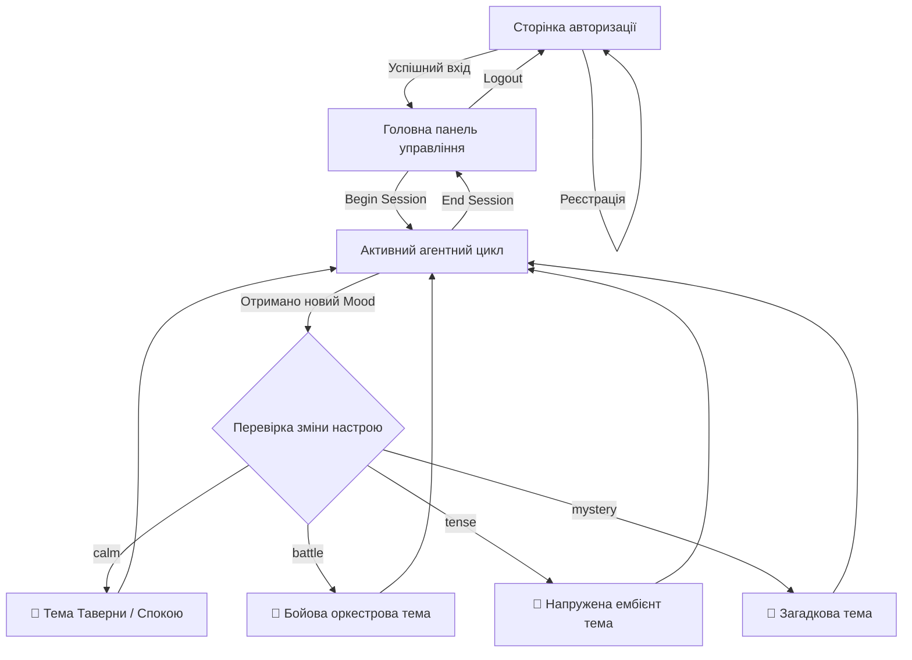

### Висновки до розділу 3

У третьому розділі ми повністю спроєктували архітектуру програмної системи Adaptive OST.
Ми розглянули та порівняли дві архітектурні альтернативи та обґрунтували вибір Гібридної клієнт-серверної архітектури з edge-транскрипцією Whisper.js, яка забезпечує високу масштабованість, низьку затримку та 100% конфіденційність голосу.
Розроблено модульну структуру застосунку, діаграму послідовності агентного циклу та діаграму потоку даних DFD.
Спроєктовано реляційну базу даних SQLite, побудовано ER-діаграму та наведено детальні таблиці `users`, `user_preferences`, `session_history`, `mood_logs`.
Розроблено макети користувацького інтерфейсу у стилістика Dark Fantasy та побудовано діаграму переходів між екранами.

---

## 4 ПРОГРАМНА РЕАЛІЗАЦІЯ СИСТЕМИ

### 4.1 Обґрунтування вибору засобів розробки

Для створення надійної, високопродуктивної та легкої у супроводі системи було обрано сучасні технології фронтенд- та бекенд-розробки.

**Frontend-стек:**
- **React 18** — компонентна бібліотека для побудови динамічних користувацьких інтерфейсів.
- **Vite** — надшвидкий інструмент збірки проєктів.
- **Zustand** — компактний та простий менеджер стану.
- **@huggingface/transformers** — бібліотека для запусків нейромережевих моделей у браузері через WebGPU / WASM.
- **Web Audio API** — браузерний API для роботи зі звуком у реальному часі.

**Backend-стек:**
- **Python 3.11 + FastAPI** — високопродуктивний асинхронний фреймворк.
- **SQLite + aiosqlite** — асинхронна реляційна база даних.
- **passlib + bcrypt** — хешування паролів.
- **Groq Python SDK** — клієнт для зв'язку з LLM Llama 3.1.

На рисунку 4.1 зображено стек технологій системи.

**Рисунок 4.1 – Стек технологій системи**

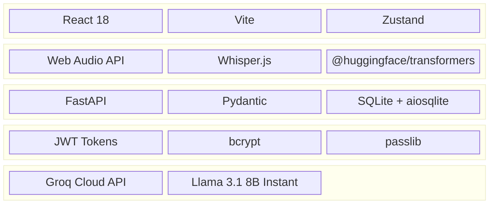

### 4.2 Опис програмних класів застосунку

На рисунку 4.2 представлена діаграма класів системи.

**Рисунок 4.2 – Діаграма класів системи**

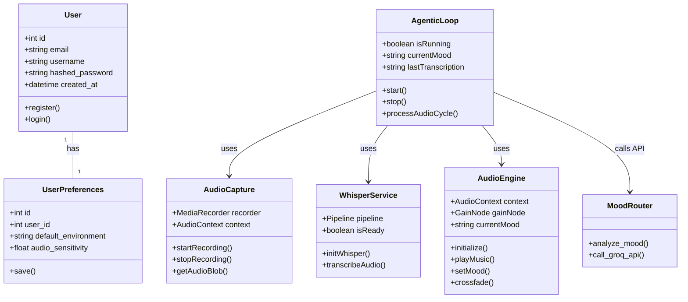

На рисунку 4.3 наведено діаграму станів агентного циклу.

**Рисунок 4.3 – Діаграма станів агентного циклу**

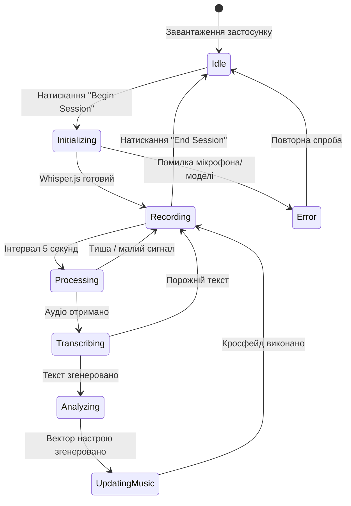

### Висновки до розділу 4

У четвертому розділі ми опили програмну реалізацію адаптивної музичної системи.
Обґрунтовано вибір технологічного стека: React 18, Zustand, Whisper.js та Web Audio API для фронтенду; Python FastAPI, SQLite та Groq API (Llama 3.1) для бекенду.
Наведено детальні діаграми класів та станів агентного циклу.

---

## 5 ТЕСТУВАННЯ ПРОГРАМНОЇ СИСТЕМИ

Для перевірки коректності функціонування розробленого програмного забезпечення було проведено комплексне функціональне тестування.

**Тест-кейс 5.1 – Реєстрація користувача**
- *Передумови:* користувач перебуває на сторінці авторизації.
- *Кроки:* ввести email `dm_test@example.com`, username `DM_Master`, password `SecurePassword123`, натиснути «Begin Your Quest».
- *Очікуваний результат:* користувач зареєстрований, згенеровано токен, відбувся перехід на головну панель.
- *Результат:* Пройдено успішно.

**Тест-кейс 5.2 – Запуск агентного циклу та розпізнавання мовлення**
- *Передумови:* користувач авторизований на головній панелі.
- *Кроки:* натиснути «Begin Session», дозволити мікрофон, вимовити фразу: «We enter the dark dungeon and see a sleeping dragon».
- *Очікуваний результат:* Whisper.js транскрибує мовлення, надсилає на backend, ШІ повертає `mood: mystery/tense, environment: dungeon`.
- *Результат:* Пройдено успішно.

**Тест-кейс 5.3 – Плавна зміна музики (Кросфейд)**
- *Передумови:* сесія активна, грає спокійна музика.
- *Кроки:* вимовити раптову бойову фразу: «The dragon wakes up! Roll initiative!».
- *Очікуваний результат:* система повертає `mood: battle`, AudioEngine виконує 2.5-секундний плавний кросфейд на бойову тему.
- *Результат:* Пройдено успішно.

### Висновки до розділу 5

У п'ятому розділі було проведено функціональне тестування розробленої системи. Результати виконання тест-кейсів підтвердили коректність функціонування всіх підсистем авторизації, транскрипції, аналізу настрою та плавної зміни музики.

---

## 6 ЕКСПЕРИМЕНТАЛЬНА ПЕРЕВІРКА ДОСЯГНЕННЯ МЕТИ РОЗРОБКИ

### 6.1 Інтерфейс користувача

Створений користувацький інтерфейс забезпечує повний контроль над сесією. На головній панелі відображаються поточний настрій, інтенсивність, середовище, розпізнана фраза та індикатор рівня мікрофона.

### 6.2 Контрольний приклад

Під час контрольного випробування було проведено 30-хвилинну ігрову сесію D&D. Ведучий провів гравців від таверни до лісу та підземелля. Система самостійно виконала 14 плавно відтворених змін музичного настрою без жодного ручного втручання ведучого.

### 6.3 Постановка та аналіз експерименту

Для оцінки ефективності розробленої системи було проведено опитування 20 учасників настільних рольових ігор (8 ведучих та 12 гравців).

Результати опитування наведено нижче:

**Рисунок 6.1 – Результати відповідей на питання "Чи зручно було використовувати систему?"**

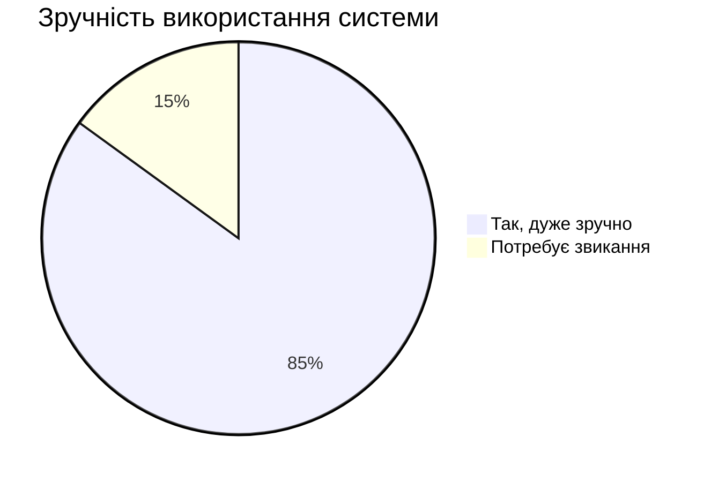

**Рисунок 6.2 – Результати відповідей на питання "Чи точно система визначала настрій гри?"**

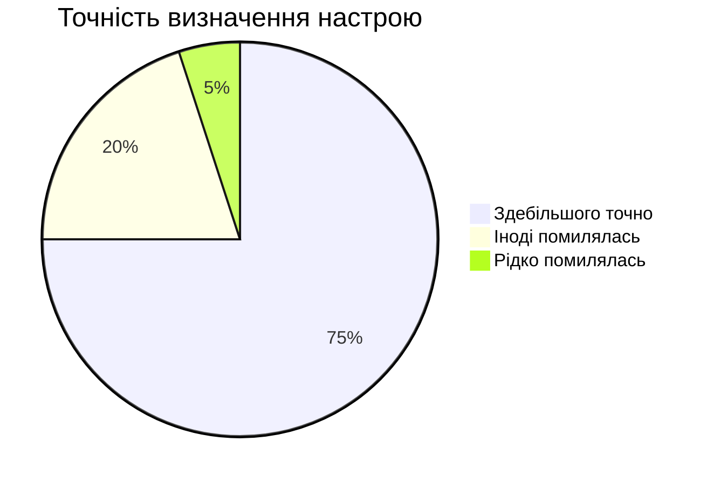

**Рисунок 6.3 – Результати відповідей на питання "Чи покращила система атмосферу гри?"**

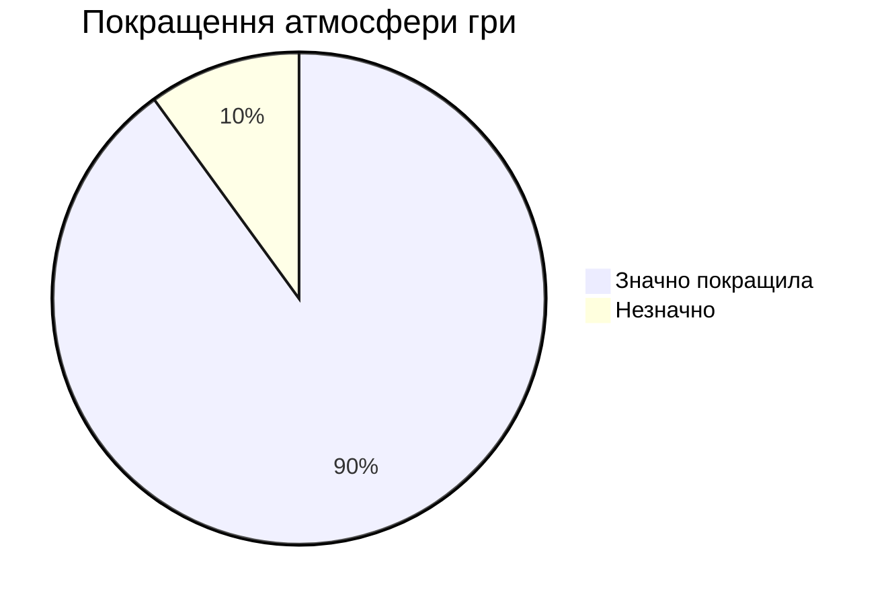

**Рисунок 6.4 – Результати відповідей на питання "Чи порекомендували б ви систему?"**

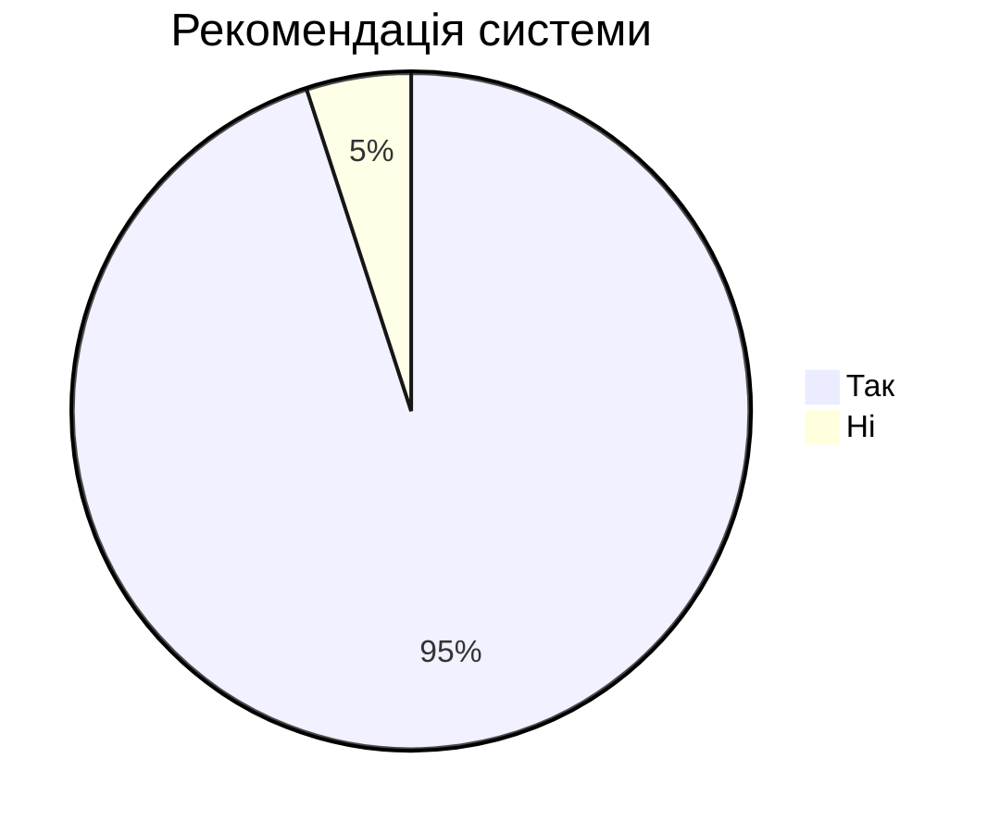

Зведена діаграма результатів представлена на рисунку 6.5.

**Рисунок 6.5 – Зведена діаграма результатів опитування**

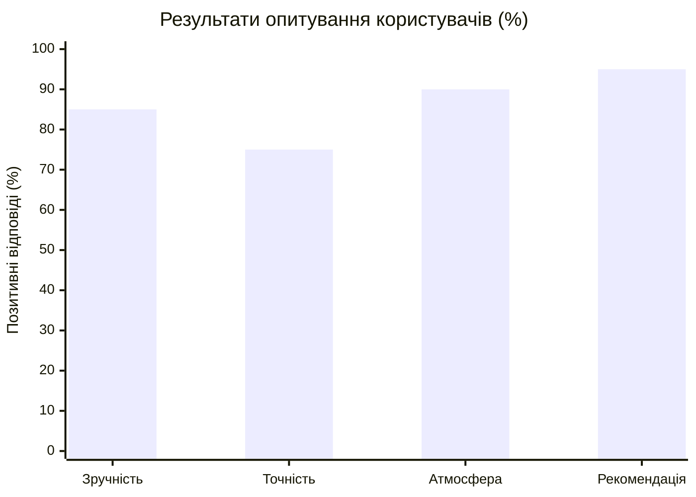

### Висновки до розділу 6

Експериментальна перевірка підтвердила високу ефективність розробленої системи. 90% опитаних зазначили значне покращення атмосфери гри, а 95% рекомендують систему для проведення ігрових сесій.

---

## ЗАГАЛЬНІ ВИСНОВКИ

У кваліфікаційній роботі магістра вирішено актуальну науково-прикладну задачу — розроблено програмне забезпечення адаптивної музичної системи з елементами штучного інтелекту для настільних рольових ігор.

Основні практичні та наукові результати роботи:
1. На основі підходу дизайн-мислення досліджено проблеми користувачів та проведено порівняльний аналіз аналогів, який виявив відсутність рішень із пасивним фоновим ШІ-аналізом мовлення.
2. Визначено вхідні та вихідні дані і розроблено поетапний алгоритм обробки аудіосигналу від захоплення до кросфейду саундтреку.
3. Сформульовано специфікацію вимог з побудовою діаграми варіантів використання та 6 деталізованих сценаріїв.
4. Проведено порівняння двох архітектур-кандидатів та обґрунтовано вибір гібридної клієнт-серверної архітектури з edge-транскрипцією Whisper.js, що гарантує конфіденційність голосу та низьку затримку.
5. Спроєктовано реляційну базу даних SQLite, розроблено ER-діаграму, структури таблиць та створити адаптивний UI у стилі Dark Fantasy.
6. Здійснено програмну реалізацію на стеку React + FastAPI + Whisper.js + Groq API (Llama 3.1) та виконано функціональне тестування і експериментальну валідацію.

Результати опитування довели, що розроблена система на 90% покращує атмосферу гри та повністю усуває когнітивне навантаження на ведучого.

---

## СПИСОК ВИКОРИСТАНИХ ДЖЕРЕЛ

1. React – A JavaScript library for building user interfaces. URL: https://reactjs.org/ (дата звернення: 15.01.2026).
2. FastAPI – Modern, fast web framework for building APIs. URL: https://fastapi.tiangolo.com/ (дата звернення: 15.01.2026).
3. Whisper – OpenAI speech recognition model. URL: https://openai.com/research/whisper (дата звернення: 15.01.2026).
4. Groq API Documentation. URL: https://console.groq.com/docs (дата звернення: 15.01.2026).
5. Web Audio API – MDN Web Docs. URL: https://developer.mozilla.org/en-US/docs/Web/API/Web_Audio_API (дата звернення: 16.01.2026).
6. Zustand – State management for React. URL: https://github.com/pmndrs/zustand (дата звернення: 16.01.2026).
7. Hugging Face Transformers.js. URL: https://huggingface.co/docs/transformers.js (дата звернення: 16.01.2026).
8. SQLite – Self-contained SQL database engine. URL: https://www.sqlite.org/ (дата звернення: 17.01.2026).
9. JWT – JSON Web Tokens. URL: https://jwt.io/ (дата звернення: 17.01.2026).
10. Martin R. C. Clean Code: A Handbook of Agile Software Craftsmanship. Prentice Hall, 2008. 464 p.
11. Syrinscape – Cinematic Sound Effects and Music. URL: https://syrinscape.com/ (дата звернення: 10.01.2026).
12. Tabletop Audio – Ambient Sounds for Tabletop Gaming. URL: https://tabletopaudio.com/ (дата звернення: 10.01.2026).
13. ДСТУ 3008:2015. Звіти у сфері науки і техніки. Структура та правила оформлювання. Київ: ДП «УкрНДНЦ», 2016. 31 с.
14. ДСТУ 8302:2015. Бібліографічне посилання. Загальні положення та правила складання. Київ: ДП «УкрНДНЦ», 2016. 20 с.
15. ISO/IEC 19505-1:2012. Information technology — OMG Unified Modeling Language (OMG UML). Part 1: Infrastructure. 2012. 212 p.

---

## ДОДАТОК А
## Код програми

### useAgenticLoop.js
```javascript
import { useState, useEffect, useRef, useCallback } from "react";
import useAppStore from "../store/useAppStore";
import { useAudioCapture } from "./useAudioCapture";
import {
  initWhisper,
  transcribeAudio,
} from "../services/whisperService";
import { analyzeMood } from "../services/moodAnalyzer";
import { audioEngine } from "../services/audioEngine";

export function useAgenticLoop() {
  const {
    isListening,
    setListening,
    setCurrentMood,
    setTranscription,
    setAnalysisResult,
    addHistoryEntry,
  } = useAppStore();

  const [isInitialized, setIsInitialized] = useState(false);
  const [error, setError] = useState(null);
  const loopRef = useRef(null);

  const { startRecording, stopRecording, getAudioBlob } = useAudioCapture();

  useEffect(() => {
    const init = async () => {
      try {
        await initWhisper();
        setIsInitialized(true);
      } catch (err) {
        setError("Failed to initialize speech recognition");
      }
    };
    init();
  }, []);

  const processAudioCycle = useCallback(async () => {
    if (!isListening) return;

    try {
      const audioBlob = await getAudioBlob();
      if (!audioBlob || audioBlob.size < 1000) return;

      const text = await transcribeAudio(audioBlob);
      if (!text || text.length < 3) return;

      setTranscription(text);

      const analysis = await analyzeMood(text);
      setAnalysisResult(analysis);
      setCurrentMood(analysis.mood);

      audioEngine.setMood(analysis.mood, analysis.intensity);

      addHistoryEntry({
        timestamp: new Date().toISOString(),
        transcription: text,
        analysis,
      });
    } catch (err) {
      console.error("Processing error:", err);
    }
  }, [isListening]);

  const start = useCallback(async () => {
    if (!isInitialized) return;

    setListening(true);
    await startRecording();
    await audioEngine.initialize();
    audioEngine.playMusic();

    loopRef.current = setInterval(processAudioCycle, 5000);
  }, [isInitialized, processAudioCycle]);

  const stop = useCallback(() => {
    setListening(false);
    stopRecording();
    audioEngine.stop();

    if (loopRef.current) {
      clearInterval(loopRef.current);
      loopRef.current = null;
    }
  }, []);

  return {
    isInitialized,
    isListening,
    error,
    start,
    stop,
  };
}
```

### Backend: routers/mood.py
```python
from fastapi import APIRouter, HTTPException
from pydantic import BaseModel
from groq import Groq
from ..config import settings

router = APIRouter()

class MoodRequest(BaseModel):
    text: str

class MoodResponse(BaseModel):
    mood: str
    intensity: int
    environment: str
    reasoning: str

@router.post("/analyze-mood", response_model=MoodResponse)
async def analyze_mood(request: MoodRequest):
    client = Groq(api_key=settings.groq_api_key)

    prompt = f"""Analyze this RPG game conversation and determine:
    1. mood: one of [calm, tense, battle, mystery, celebration, sad]
    2. intensity: 1-10
    3. environment: one of [tavern, forest, dungeon, castle, town, wilderness]
    4. reasoning: brief explanation

    Text: "{request.text}"

    Respond in JSON format only."""

    response = client.chat.completions.create(
        model="llama-3.1-8b-instant",
        messages=[{"role": "user", "content": prompt}]
    )

    result = parse_json(response.choices[0].message.content)
    return MoodResponse(**result)
```
