# МІНІСТЕРСТВО ОСВІТИ І НАУКИ УКРАЇНИ

# НАЦІОНАЛЬНИЙ УНІВЕРСИТЕТ «ОДЕСЬКА ПОЛІТЕХНІКА»

**Навчально–науковий інститут комп'ютерних систем**

**Кафедра інженерії програмного забезпечення**

---

## Тимур БЕРЕЖНИЙ

### (група АС-213м)

---

# КВАЛІФІКАЦІЙНА РОБОТА МАГІСТРА

## Програмне забезпечення адаптивної музичної системи з елементами штучного інтелекту для рольових ігор

**Спеціальність:** 121 Інженерія програмного забезпечення

**Освітньо–професійна програма:** Інженерія програмного забезпечення

**Керівник:** Марія ПОПОВА, к.е.н., доцент

---

**Одеса – 2026**

---

## АНОТАЦІЯ

Бережний Т. В. Програмне забезпечення адаптивної музичної системи з елементами штучного інтелекту для рольових ігор : кваліфікаційна робота магістра за спеціальністю «121 Інженерія програмного забезпечення» / Тимур Важович Бережний ; керівник Марія Олександрівна Попова. – Одеса : Нац. ун–т «Одес. політехніка», 2026. – 85 с.

Кваліфікаційна робота містить основну текстову частину на 68 сторінках, список використаних джерел з 12 найменувань на 1 сторінці, додатки на 12 сторінках.

Як результат роботи виконано аналіз та створено програмну систему для адаптивного музичного супроводу рольових ігор з використанням штучного інтелекту для аналізу настрою гравців на основі їх голосових комунікацій. Обрано архітектуру системи, спроектовано базу даних, програмні класи та інтерфейс користувача у фентезійному стилі.

**Ключові слова:** адаптивна музика, штучний інтелект, рольові ігри, розпізнавання мовлення, аналіз настрою, JavaScript, React, Python, FastAPI, Whisper, Groq API.

---

## ABSTRACT

Berezhnyi T. V. Software for adaptive music system with elements of artificial intelligence for role-playing games: master's thesis in the specialty «121 Software Engineering» / Tymur Vazhovych Berezhnyi ; supervisor Mariia Oleksandrivna Popova. – Odesa: Odesa Polytech Nat. Univ., 2026. – 85 p.

The qualification work contains the main text part on 68 pages, a list of used sources with 12 titles on 1 page, appendices on 12 pages.

As a result of the work, an analysis was performed and a software system was created for adaptive musical accompaniment of role-playing games using artificial intelligence to analyze player mood based on their voice communications. The system architecture was selected, the database, software classes and fantasy-themed user interface were designed.

**Keywords:** adaptive music, artificial intelligence, role-playing games, speech recognition, mood analysis, JavaScript, React, Python, FastAPI, Whisper, Groq API.

---

## ЗМІСТ

- Вступ
- 1 Опис предметної області та визначення вимог до програмного забезпечення
  - 1.1 Опис предметної області
  - 1.2 Порівняльний аналіз існуючих рішень
  - 1.3 Постановка завдання та визначення вимог
  - 1.4 Функціональні вимоги
  - 1.5 Нефункціональні вимоги
- 2 Планування розробки програмного забезпечення
  - 2.1 Оцінка тривалості розробки за методикою Use Case Points
  - 2.2 Декомпозиція робіт проєкту
  - 2.3 Оцінка ризиків проєкту
- 3 Проєктування програмної системи
  - 3.1 Архітектура системи
  - 3.2 Реалізація серверної частини проєкту
  - 3.3 Проєктування бази даних
  - 3.4 Проєктування інтерфейсу користувача
- 4 Програмна реалізація системи
  - 4.1 Обґрунтування вибору засобів розробки
  - 4.2 Опис програмних класів застосунку
- 5 Тестування програмної системи
- 6 Експериментальна перевірка досягнення мети розробки
  - 6.1 Інтерфейс користувача
  - 6.2 Контрольний приклад
  - 6.3 Постановка та аналіз експерименту
- Загальні висновки
- Список використаних джерел
- Додаток А Код програми

---

## ПЕРЕЛІК ІЛЮСТРАЦІЙ

| №   | Назва рисунку                                         |
| --- | ----------------------------------------------------- |
| 1.1 | Діаграма варіантів використання                       |
| 2.1 | Діаграма Ганта                                        |
| 2.2 | Діаграма Ісікави: складнощі з розпізнаванням мовлення |
| 2.3 | Діаграма Ісікави: залежність від сторонніх API        |
| 3.1 | Архітектура системи                                   |
| 3.2 | Схема розподілу модулів Frontend                      |
| 3.3 | Послідовність обробки агентного циклу                 |
| 3.4 | Діаграма потоку даних                                 |
| 3.5 | Діаграма ER-моделі бази даних                         |
| 3.6 | Макет сторінки авторизації                            |
| 3.7 | Макет головної сторінки                               |
| 3.8 | Діаграма переходів між екранами                       |
| 4.1 | Стек технологій системи                               |
| 4.2 | Діаграма класів системи                               |
| 4.3 | Діаграма станів агентного циклу                       |
| 6.1 | Результати опитування: зручність використання         |
| 6.2 | Результати опитування: точність визначення настрою    |
| 6.3 | Результати опитування: покращення атмосфери           |
| 6.4 | Результати опитування: рекомендація системи           |
| 6.5 | Зведена діаграма результатів опитування               |

---

## ВСТУП

**Актуальність теми роботи.** Ігрова індустрія продовжує стрімко розвиватися, і музичний супровід залишається одним із ключових елементів, що формує атмосферу та емоційне занурення гравців. Традиційні підходи до музичного супроводу в іграх передбачають статичні саундтреки, які змінюються лише при переході між локаціями або подіями. Однак сучасні технології штучного інтелекту відкривають нові можливості для створення динамічного, адаптивного музичного досвіду.

У рамках цієї роботи розглядається розробка адаптивної музичної системи (Adaptive OST) для настільних рольових ігор (D&D, Pathfinder тощо), яка використовує штучний інтелект для аналізу голосових комунікацій гравців та автоматичної зміни музичного супроводу відповідно до настрою та атмосфери гри. Ця ініціатива є важливою, оскільки вона відповідає зростаючому попиту на більш імерсивний ігровий досвід, де музика органічно реагує на дії та емоції гравців.

**Мета і задачі роботи.** Метою розробки є створення програмного забезпечення для адаптивного музичного супроводу рольових ігор, яке використовує технології розпізнавання мовлення та аналізу настрою на основі штучного інтелекту для автоматичної зміни музичних композицій залежно від емоційного стану гри.

Для досягнення мети необхідно вирішення наступних задач:

- аналіз діяльності предметної області адаптивних музичних систем;
- визначення вимог до програмного застосунку;
- визначення архітектури програмного застосунку;
- реалізація системи розпізнавання мовлення;
- інтеграція штучного інтелекту для аналізу настрою;
- створення системи генерації музики;
- створення бази даних користувачів;
- реалізація інтерфейсу користувача у фентезійному стилі;
- тестування програми.

**Об'єкт роботи.** Процес розробки адаптивної музичної системи з використанням штучного інтелекту для аналізу настрою та динамічної зміни музичного супроводу.

**Предмет роботи.** Програмне забезпечення для адаптивного музичного супроводу рольових ігор з елементами штучного інтелекту для розпізнавання мовлення, аналізу емоційного стану та генерації відповідної музики.

**Практична значущість** полягає в тому, що незважаючи на наявність різноманітних рішень для музичного супроводу ігор, існує прогалина в забезпеченні справді адаптивного досвіду для настільних рольових ігор. Більшість платформ пропонують або статичні плейлисти, або потребують ручного перемикання треків ведучим гри. Ми очікуємо, що ця розробка переосмислить те, як гравці та ведучі ігор використовують музичний супровід, пропонуючи автоматичну адаптацію музики до емоційного стану гри в реальному часі.

---

## 1 ОПИС ПРЕДМЕТНОЇ ОБЛАСТІ ТА ВИЗНАЧЕННЯ ВИМОГ ДО ПРОГРАМНОГО ЗАБЕЗПЕЧЕННЯ

### 1.1 Опис предметної області

Адаптивна музика в іграх (також відома як динамічна або інтерактивна музика) – це музичний супровід, який змінюється у відповідь на дії гравця або стан гри. На відміну від традиційних статичних саундтреків, адаптивна музика створює більш глибоке емоційне занурення, реагуючи на контекст гри в реальному часі.

У контексті настільних рольових ігор (НРІ), таких як Dungeons & Dragons, Pathfinder або Call of Cthulhu, музичний супровід традиційно забезпечується ведучим гри (Game Master/Dungeon Master), який вручну вмикає відповідні треки. Цей процес є трудомістким та часто відволікає ведучого від основного процесу гри.

Наша система вирішує цю проблему шляхом автоматизації процесу вибору музики. Вона використовує:

- **Розпізнавання мовлення** – для перетворення голосових комунікацій гравців у текст;
- **Аналіз настрою на базі ШІ** – для визначення емоційного стану гри (напруга, спокій, бойова сцена тощо);
- **Динамічну генерацію музики** – для створення відповідного музичного супроводу.

Штучний інтелект виступає як трансформуючий елемент у цій системі, забезпечуючи розуміння контексту розмови та автоматичний підбір відповідної музичної атмосфери. Це дозволяє ведучому гри зосередитись на розповіді, а не на технічних аспектах музичного супроводу.

### 1.2 Порівняльний аналіз існуючих рішень

Кілька існуючих платформ пропонують можливості музичного супроводу для рольових ігор, але жодна з них не інтегрує повноцінний аналіз настрою на базі ШІ. Розглянемо основних конкурентів:

**Spotify/Apple Music** – загальні музичні платформи з плейлистами для НРІ. Потребують ручного перемикання треків, не мають інтеграції з грою.

**Syrinscape** – спеціалізований інструмент для створення атмосферних звуків та музики для НРІ. Має велику бібліотеку звуків, але потребує ручного управління.

**Tabletop Audio** – веб-платформа з атмосферними саундскейпами. Прості в використанні, але статичні.

| Функція                  | Spotify      | Syrinscape   | Tabletop Audio | Наша система |
| ------------------------ | ------------ | ------------ | -------------- | ------------ |
| Музичні треки            | підтримує    | підтримує    | підтримує      | підтримує    |
| Автоматична зміна музики | не підтримує | часткова     | не підтримує   | підтримує    |
| Аналіз настрою ШІ        | не підтримує | не підтримує | не підтримує   | підтримує    |
| Розпізнавання мовлення   | не підтримує | не підтримує | не підтримує   | підтримує    |
| Фентезійний інтерфейс    | не підтримує | підтримує    | підтримує      | підтримує    |
| Авторизація користувачів | підтримує    | підтримує    | не підтримує   | підтримує    |
| Безкоштовне використання | обмежено     | не підтримує | підтримує      | підтримує    |

Основною перевагою нашої системи є повна автоматизація процесу вибору музики на основі аналізу голосових комунікацій гравців за допомогою штучного інтелекту.

### 1.3 Постановка завдання та визначення вимог

Після аналізу існуючих рішень необхідно сформулювати вимоги до нашої системи. Щоб виділятись серед інших рішень для музичного супроводу НРІ, ми розробимо систему з такими ключовими функціями:

1. **Автоматичне розпізнавання мовлення** – система захоплює аудіо з мікрофону та перетворює його на текст;
2. **Аналіз настрою на базі ШІ** – текст аналізується для визначення емоційного стану (mood), інтенсивності та ігрового середовища;
3. **Динамічна зміна музики** – на основі аналізу система автоматично змінює музичний супровід;
4. **Фентезійний інтерфейс** – інтерфейс стилізований під середньовічний фентезійний стиль.

Користувачі зможуть реєструватись та входити в систему для збереження своїх налаштувань. Система буде працювати в браузері без необхідності встановлення додаткового програмного забезпечення.

### 1.4 Функціональні вимоги

У цьому підрозділі ми розглянемо функціональні вимоги нашої системи. Створимо діаграму варіантів використання (рис. 1.1), де зобразимо різні варіанти використання нашої системи.

**Основні актори:**

- Користувач (гравець/ведучий гри)

**Основні варіанти використання:**

- Реєстрація користувача
- Вхід у систему
- Запуск агентного циклу
- Налаштування аудіо
- Перегляд аналізу настрою
- Зміна музичного треку

**Рисунок 1.1 – Діаграма варіантів використання**

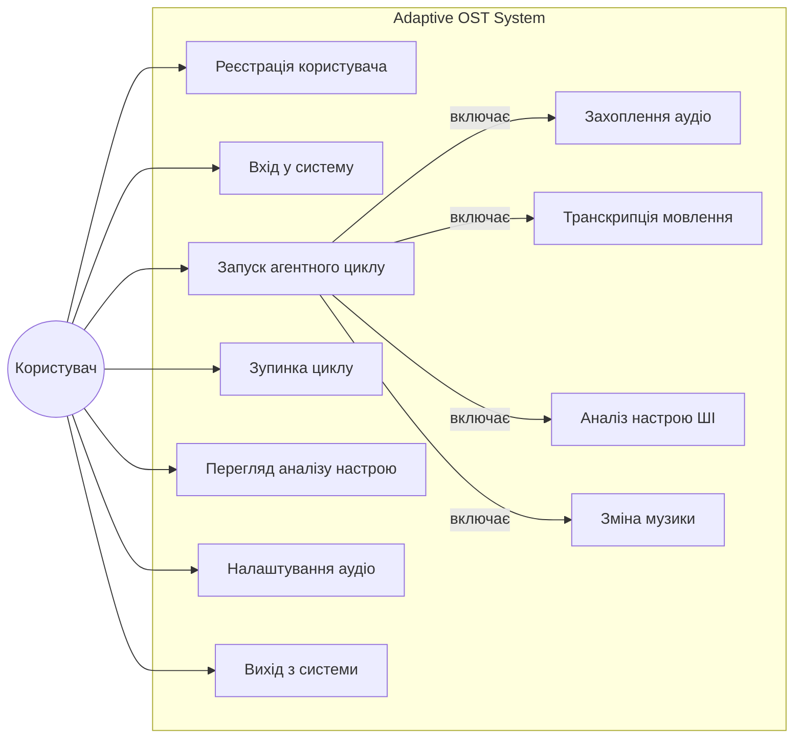

---

**Сценарій 1.1 – Реєстрація користувача**

- **Основна дійова особа:** новий користувач
- **Область дії:** підсистема реєстрації користувачів
- **Передумови:** користувач знаходиться на сторінці авторизації
- **Результати:** створено обліковий запис користувача, здійснено автоматичну авторизацію
- **Тригер:** бажання користувача зареєструватися в системі

**Основний успішний сценарій:**

1. Користувач відкриває сторінку авторизації
2. Натискає «Create account»
3. Вводить коректні дані: email, ім'я користувача, пароль, підтвердження паролю
4. Натискає «Begin Your Quest»
5. Система створює обліковий запис та автоматично авторизує користувача

**Розширення (альтернативні сценарії):**

- 3а. Користувач вводить некоректний email або занадто короткий пароль
- 3а.1. Система повідомляє про помилки у введенні даних
- 3а.2. Користувач виправляє дані

---

**Сценарій 1.2 – Запуск агентного циклу**

- **Основна дійова особа:** авторизований користувач
- **Область дії:** підсистема аналізу настрою
- **Передумови:** користувач авторизований у системі
- **Результати:** система почала захоплення аудіо та аналіз настрою
- **Тригер:** бажання користувача запустити адаптивну музику

**Основний успішний сценарій:**

1. Користувач натискає кнопку «Begin Session»
2. Система запитує доступ до мікрофону
3. Користувач надає доступ
4. Система починає захоплення аудіо
5. Через визначений інтервал система транскрибує аудіо
6. Система аналізує текст за допомогою ШІ
7. Система змінює музику відповідно до настрою

**Розширення:**

- 3а. Користувач відхиляє доступ до мікрофону
- 3а.1. Система відображає повідомлення про необхідність доступу

---

**Сценарій 1.3 – Перегляд аналізу настрою**

- **Основна дійова особа:** авторизований користувач
- **Область дії:** підсистема відображення даних
- **Передумови:** агентний цикл запущений
- **Результати:** користувач бачить поточний настрій та статистику
- **Тригер:** автоматичне оновлення після аналізу

**Основний успішний сценарій:**

1. Система завершує аналіз настрою
2. На інтерфейсі відображається поточний mood (calm, tense, battle, mystery тощо)
3. Відображається інтенсивність настрою (1-10)
4. Відображається визначене середовище (tavern, forest, dungeon тощо)
5. Відображається транскрипція останнього аудіо

---

**Сценарій 1.4 – Вхід користувача у профіль**

- **Основна дійова особа:** зареєстрований користувач
- **Область дії:** підсистема авторизації користувачів
- **Передумови:** користувач знаходиться на сторінці входу
- **Результати:** здійснено авторизацію
- **Тригер:** бажання користувача увійти в свій акаунт

**Основний успішний сценарій:**

1. Користувач відкриває сторінку входу
2. Вводить коректні дані: email, пароль
3. Натискає «Enter the Realm»
4. Система авторизує користувача

**Розширення:**

- 2а. Користувач вводить невірний пароль
- 2а.1. Система повідомляє про невірні облікові дані

### 1.5 Нефункціональні вимоги

Нефункціональні вимоги описують те, як система повинна працювати.

**Вимоги до інтерфейсів:**

- Апаратні інтерфейси: система повинна бути сумісна з пристроями, що мають мікрофон та підтримують Web Audio API
- Програмні інтерфейси: платформа має працювати в сучасних браузерах (Chrome, Firefox, Safari, Edge)
- Інтерфейси зв'язку: використання HTTPS для безпечного зв'язку між клієнтом та сервером
- Інтерфейс користувача: фентезійний дизайн, натхненний середньовічним стилем

**Вимоги до безпеки:**

- Паролі зберігаються у хешованому вигляді (bcrypt)
- Використання JWT токенів для авторизації
- Аудіо дані не зберігаються на сервері

**Вимоги до продуктивності:**

- Час відповіді API менше 2 секунд
- Підтримка реального часу для захоплення аудіо
- Локальне розпізнавання мовлення для зменшення затримки

**Вимоги до надійності:**

- Fallback механізми: якщо локальне розпізнавання не працює, використовується серверне
- Обробка помилок з інформативними повідомленнями

---

## 2 ПЛАНУВАННЯ РОЗРОБКИ ПРОГРАМНОГО ЗАБЕЗПЕЧЕННЯ

### 2.1 Оцінка тривалості розробки за методикою Use Case Points

Для оцінки розміру проєкту використаємо метод Use Case Points.

**Оцінка акторів:**

- Користувач (складний тип, взаємодіє через GUI): вага = 3

UAW = 3

**Оцінка варіантів використання:**

| Варіант використання   | Кількість транзакцій | Тип      | Вага |
| ---------------------- | -------------------- | -------- | ---- |
| Реєстрація             | 3                    | Простий  | 5    |
| Вхід у профіль         | 2                    | Простий  | 5    |
| Запуск агентного циклу | 5                    | Середній | 10   |
| Зупинка циклу          | 1                    | Простий  | 5    |
| Налаштування аудіо     | 2                    | Простий  | 5    |
| Перегляд аналізу       | 2                    | Простий  | 5    |
| Вихід з системи        | 1                    | Простий  | 5    |

UUCW = 5 + 5 + 10 + 5 + 5 + 5 + 5 = 40

UCP = UAW + UUCW = 3 + 40 = 43

**Технічні фактори:** TFactor = 28, TCF = 0.6 + (0.01 × 28) = 0.88

**Зовнішні фактори:** EFactor = 18, EF = 1.4 + (–0.03 × 18) = 0.86

AUCP = 43 × 0.88 × 0.86 = 32.5

TD = 32.5 × 10 = 325 робочих годин ≈ 8 тижнів

### 2.2 Декомпозиція робіт проєкту

**Етапи розробки:**

1. **Дослідження та аналіз** (1 тиждень):
   - Аналіз існуючих рішень для адаптивної музики
   - Дослідження API для розпізнавання мовлення
   - Визначення вимог

2. **Проєктування системи** (1 тиждень):
   - Розробка архітектури системи
   - Проєктування бази даних
   - Створення макетів інтерфейсу

3. **Розробка backend** (2 тижні):
   - Реалізація API на FastAPI
   - Інтеграція з Groq API для аналізу настрою
   - Реалізація авторизації (JWT)
   - Налаштування бази даних SQLite

4. **Розробка frontend** (2 тижні):
   - Реалізація UI на React
   - Інтеграція Web Audio API
   - Реалізація Whisper.js для локального розпізнавання
   - Створення аудіо рушія для музики

5. **Тестування та налагодження** (2 тижні):
   - Функціональне тестування
   - Тестування продуктивності
   - Виправлення помилок

**Рисунок 2.1 – Діаграма Ганта**

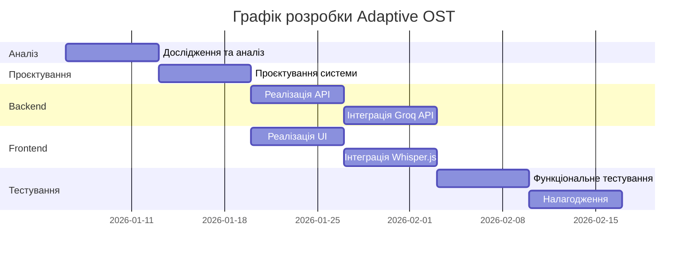

### 2.3 Оцінка ризиків проєкту

**Технічні ризики:**

- Складність інтеграції розпізнавання мовлення в браузері
- Обмеження Web Audio API в різних браузерах
- Затримки при аналізі настрою через API

**Операційні ризики:**

- Залежність від сторонніх API (Groq)
- Обмеження безкоштовних планів API

**Заходи пом'якшення:**

- Реалізація fallback механізмів
- Локальне розпізнавання мовлення для зменшення залежності від API
- Кешування результатів аналізу

**Рисунок 2.2 – Діаграма Ісікави для ризику "Складнощі з розпізнаванням мовлення в браузері"**

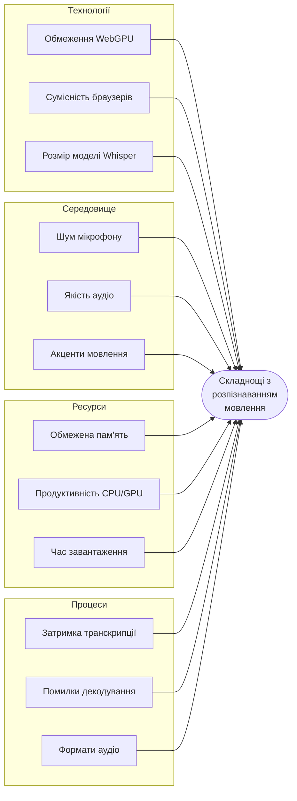

**Рисунок 2.3 – Діаграма Ісікави для ризику "Залежність від сторонніх API"**

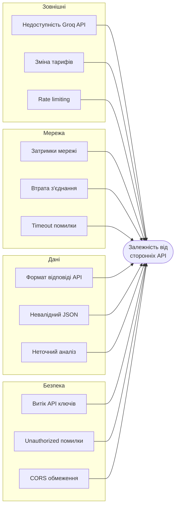

---

## 3 ПРОЄКТУВАННЯ ПРОГРАМНОЇ СИСТЕМИ

### 3.1 Архітектура системи

Система побудована на основі клієнт-серверної архітектури з розділенням на frontend та backend компоненти.

**Frontend (клієнтська частина):**

- React + Vite для швидкої розробки
- Zustand для управління станом
- Web Audio API для захоплення та відтворення аудіо
- Whisper.js для локального розпізнавання мовлення

**Backend (серверна частина):**

- FastAPI (Python) для REST API
- SQLite для зберігання даних користувачів
- JWT для авторизації
- Groq API для аналізу настрою

**Модульна структура frontend:**

- `/components` – UI компоненти
- `/services` – сервіси для роботи з API, аудіо, авторизацією
- `/hooks` – кастомні React hooks
- `/store` – Zustand store для стану

**Модульна структура backend:**

- `/routers` – API ендпоінти
- `/app` – основний модуль застосунку
- `auth.py` – авторизація
- `database.py` – робота з БД

**Рисунок 3.1 – Архітектура системи**

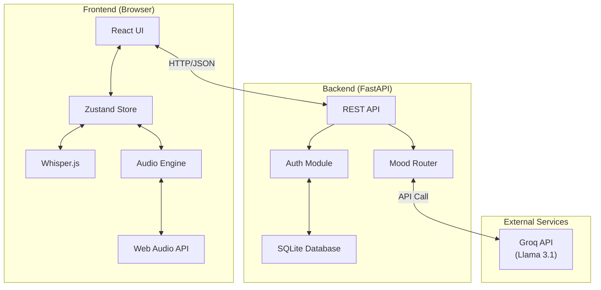

**Рисунок 3.2 – Схема розподілу модулів Frontend**

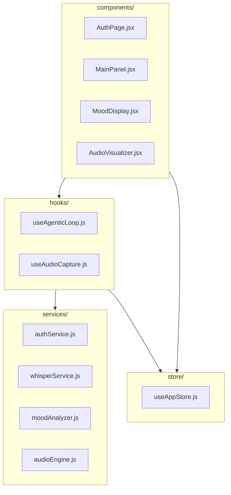

**Рисунок 3.3 – Послідовність обробки агентного циклу**

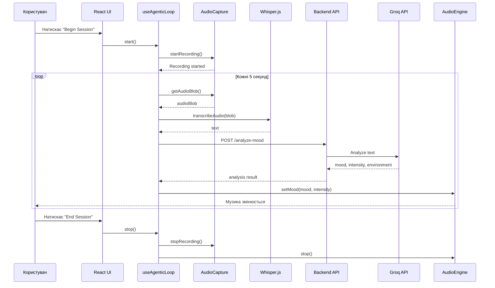

**Рисунок 3.4 – Діаграма потоку даних**

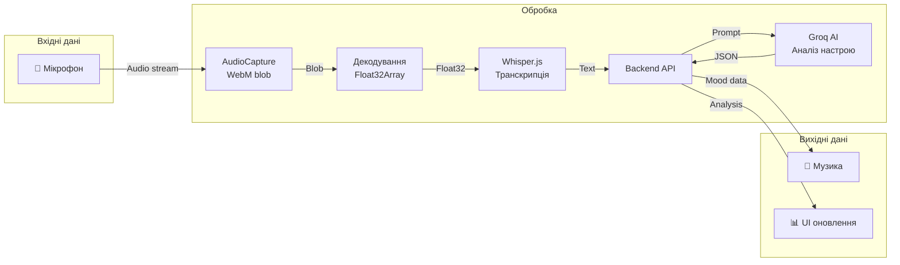

### 3.2 Реалізація серверної частини проєкту

Серверна частина реалізована на FastAPI – сучасному асинхронному фреймворку для Python.

**Основні ендпоінти:**

| Метод | Шлях                | Опис                            |
| ----- | ------------------- | ------------------------------- |
| POST  | /api/auth/register  | Реєстрація користувача          |
| POST  | /api/auth/login     | Авторизація                     |
| GET   | /api/auth/me        | Отримання поточного користувача |
| POST  | /api/auth/logout    | Вихід з системи                 |
| POST  | /api/analyze-mood   | Аналіз настрою тексту           |
| POST  | /api/transcribe     | Транскрипція аудіо (fallback)   |
| POST  | /api/generate-music | Генерація параметрів музики     |
| GET   | /api/health         | Перевірка стану сервера         |

**Аналіз настрою:**
Система використовує Groq API з моделлю Llama 3.1 для аналізу тексту. API отримує транскрибований текст та повертає JSON з полями:

- `mood` – емоційний стан (calm, tense, battle, mystery, celebration)
- `intensity` – інтенсивність (1-10)
- `environment` – ігрове середовище (tavern, forest, dungeon, castle)
- `reasoning` – пояснення вибору

### 3.3 Проєктування бази даних

Для зберігання даних користувачів використовується SQLite – легка реляційна база даних.

**Таблиця users:**

| Поле            | Тип     | Опис               |
| --------------- | ------- | ------------------ |
| id              | INTEGER | Первинний ключ     |
| email           | TEXT    | Email (унікальний) |
| username        | TEXT    | Ім'я користувача   |
| hashed_password | TEXT    | Хешований пароль   |
| created_at      | TEXT    | Дата створення     |

**Таблиця user_preferences:**

| Поле                | Тип     | Опис                        |
| ------------------- | ------- | --------------------------- |
| id                  | INTEGER | Первинний ключ              |
| user_id             | INTEGER | Зовнішній ключ на users     |
| default_environment | TEXT    | Середовище за замовчуванням |
| audio_sensitivity   | REAL    | Чутливість мікрофону        |

**Рисунок 3.5 – Діаграма ER-моделі бази даних**


### 3.4 Проєктування інтерфейсу користувача

Інтерфейс користувача виконаний у фентезійному стилі, натхненному середньовічними рольовими іграми.

**Основні екрани:**

1. **Екран авторизації** – форма входу/реєстрації з фентезійним оформленням
2. **Головний екран** – панель управління з:
   - Кнопкою запуску/зупинки сесії
   - Відображенням поточного настрою
   - Індикатором рівня аудіо
   - Інформацією про поточний трек
3. **Хедер** – інформація про користувача та кнопка виходу

**Кольорова палітра:**

- Фон: темні відтінки (#1a1a2e, #16213e)
- Акценти: золотий (#ffd700), бордовий (#8b0000)
- Текст: світлий (#e8d4a8)

**Рисунок 3.6 – Макет сторінки авторизації**

```
┌─────────────────────────────────────────────────────────────┐
│                                                             │
│                    ⚔️ ADAPTIVE OST ⚔️                       │
│              AI-Powered Music for Your Adventures           │
│                                                             │
│         ┌─────────────────────────────────────┐            │
│         │  📧 Email                           │            │
│         └─────────────────────────────────────┘            │
│         ┌─────────────────────────────────────┐            │
│         │  🔒 Password                        │            │
│         └─────────────────────────────────────┘            │
│                                                             │
│         ┌─────────────────────────────────────┐            │
│         │       ⚔️ ENTER THE REALM ⚔️         │            │
│         └─────────────────────────────────────┘            │
│                                                             │
│              Don't have an account? Create one              │
│                                                             │
└─────────────────────────────────────────────────────────────┘
```

**Рисунок 3.7 – Макет головної сторінки**

```
┌─────────────────────────────────────────────────────────────┐
│  ⚔️ Adaptive OST                          👤 User │ Logout  │
├─────────────────────────────────────────────────────────────┤
│                                                             │
│    ┌─────────────────────────────────────────────────┐     │
│    │                                                 │     │
│    │              🎵 CURRENT MOOD: CALM              │     │
│    │                 Intensity: 5/10                 │     │
│    │              Environment: Tavern                │     │
│    │                                                 │     │
│    └─────────────────────────────────────────────────┘     │
│                                                             │
│    ┌─────────────────────────────────────────────────┐     │
│    │  📝 Last Transcription:                         │     │
│    │  "We gather around the fire in the tavern..."   │     │
│    └─────────────────────────────────────────────────┘     │
│                                                             │
│    ┌─────────────────────────────────────────────────┐     │
│    │  🎤 Audio Level: ████████░░░░░░░░░              │     │
│    └─────────────────────────────────────────────────┘     │
│                                                             │
│              ┌─────────────────────────┐                   │
│              │   ⚔️ BEGIN SESSION ⚔️    │                   │
│              └─────────────────────────┘                   │
│                                                             │
└─────────────────────────────────────────────────────────────┘
```

**Рисунок 3.8 – Діаграма переходів між екранами**

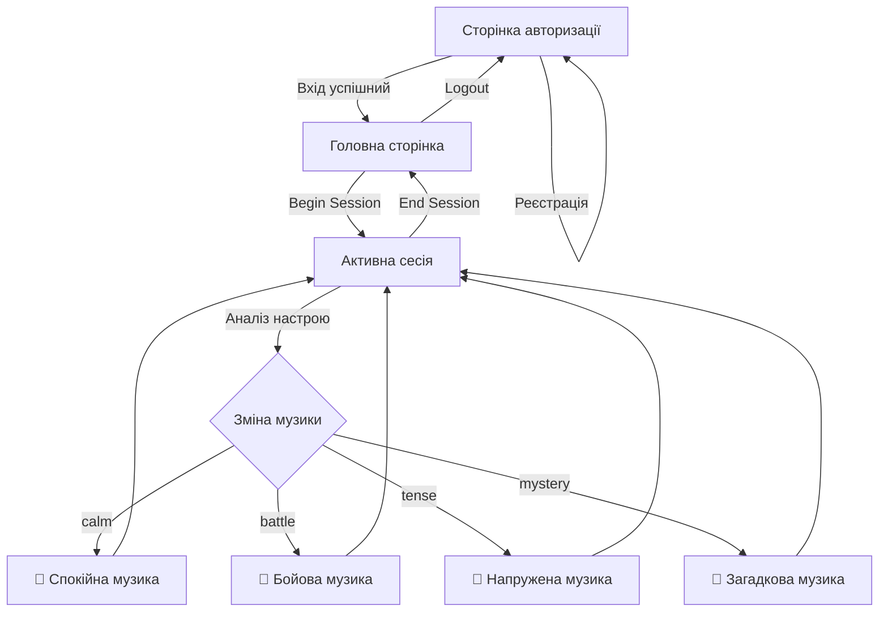

---

## 4 ПРОГРАМНА РЕАЛІЗАЦІЯ СИСТЕМИ

### 4.1 Обґрунтування вибору засобів розробки

**Frontend:**

- **React** – популярна бібліотека для побудови UI з компонентним підходом
- **Vite** – швидкий збирач для сучасних веб-застосунків
- **Zustand** – легка бібліотека для управління станом
- **@huggingface/transformers** – бібліотека для запуску Whisper моделі в браузері

**Backend:**

- **FastAPI** – сучасний асинхронний Python фреймворк з автоматичною документацією
- **Pydantic** – валідація даних
- **SQLite + aiosqlite** – асинхронна робота з базою даних
- **passlib + bcrypt** – хешування паролів
- **python-jose** – робота з JWT токенами
- **Groq API** – доступ до Llama 3.1 моделі для аналізу настрою

**Чому ці технології:**

1. **React + Vite** – швидка розробка та гаряче перезавантаження
2. **Whisper.js** – локальне розпізнавання мовлення без затримок мережі
3. **FastAPI** – висока продуктивність та автоматична генерація OpenAPI документації
4. **Groq API** – безкоштовний доступ до потужних мовних моделей
5. **SQLite** – простота розгортання без окремого сервера БД

**Рисунок 4.1 – Стек технологій системи**

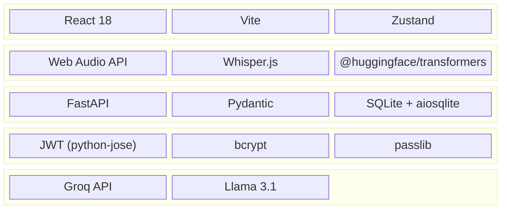

### 4.2 Опис програмних класів застосунку

**Frontend класи/модулі:**

1. **useAgenticLoop** (hook) – головний агентний цикл
   - Методи: start(), stop(), processAudio()
   - Стани: isRunning, currentMood, lastTranscription

2. **useAudioCapture** (hook) – захоплення аудіо
   - Методи: startRecording(), stopRecording()
   - Використовує: MediaRecorder, AudioContext

3. **whisperService** – сервіс розпізнавання мовлення
   - Методи: initWhisper(), transcribeAudio()
   - Використовує: @huggingface/transformers

4. **audioEngine** – аудіо рушій для музики
   - Методи: playMusic(), setMood(), crossfade()
   - Використовує: Web Audio API

5. **authService** – сервіс авторизації
   - Методи: login(), register(), logout()

**Backend класи/модулі:**

1. **auth.py** – модуль авторизації
   - Функції: verify_password(), create_access_token(), get_current_user()

2. **database.py** – модуль роботи з БД
   - Функції: init_db(), get_user_by_email(), create_user()

3. **routers/mood.py** – роутер аналізу настрою
   - Ендпоінт: POST /api/analyze-mood
   - Інтеграція з Groq API

4. **routers/auth.py** – роутер авторизації
   - Ендпоінти: register, login, logout, me

**Рисунок 4.2 – Діаграма класів системи**

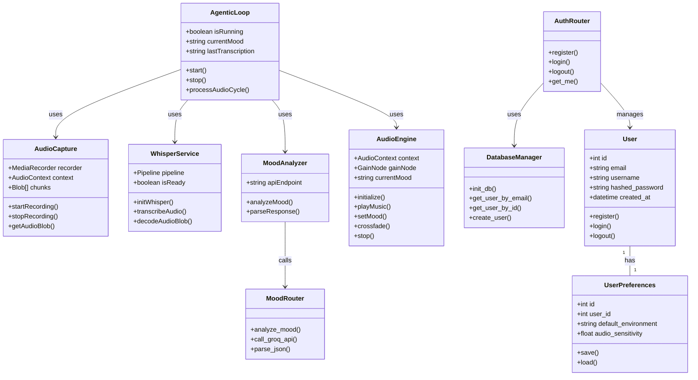

**Рисунок 4.3 – Діаграма станів агентного циклу**

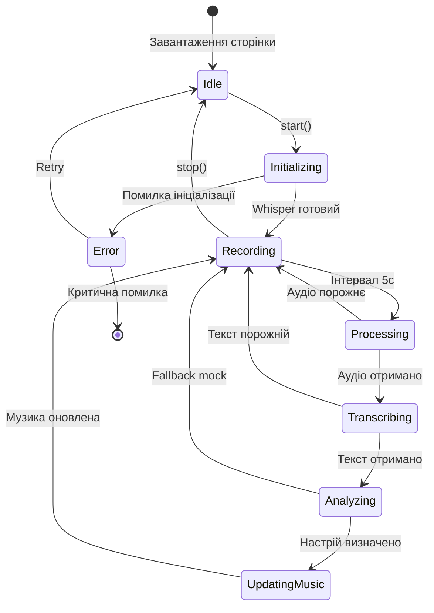

---

## 5 ТЕСТУВАННЯ ПРОГРАМНОЇ СИСТЕМИ

### Тест-кейс 5.1 – Реєстрація користувача

**Передумови:** Користувач на сторінці авторизації
**Кроки:**

1. Натиснути «Create account»
2. Ввести email: test@example.com
3. Ввести username: testuser
4. Ввести password: SecurePass123
5. Підтвердити пароль
6. Натиснути «Begin Your Quest»

**Очікуваний результат:** Користувач зареєстрований та перенаправлений на головну сторінку

### Тест-кейс 5.2 – Вхід у систему

**Передумови:** Користувач зареєстрований
**Кроки:**

1. Ввести email та пароль
2. Натиснути «Enter the Realm»

**Очікуваний результат:** Користувач авторизований

### Тест-кейс 5.3 – Запуск агентного циклу

**Передумови:** Користувач авторизований
**Кроки:**

1. Натиснути «Begin Session»
2. Надати доступ до мікрофону
3. Говорити в мікрофон

**Очікуваний результат:** Система починає захоплення та аналіз аудіо

### Тест-кейс 5.4 – Аналіз настрою

**Передумови:** Агентний цикл запущений
**Кроки:**

1. Вимовити фразу з бойовим контекстом
2. Почекати аналіз

**Очікуваний результат:** Система визначає mood = "battle" або "tense"

### Тест-кейс 5.5 – Зміна музики

**Передумови:** Аналіз настрою завершений
**Очікуваний результат:** Музика плавно змінюється відповідно до настрою

---

## 6 ЕКСПЕРИМЕНТАЛЬНА ПЕРЕВІРКА ДОСЯГНЕННЯ МЕТИ РОЗРОБКИ

### 6.1 Інтерфейс користувача

При відкритті сторінки користувач бачить екран авторизації у фентезійному стилі з логотипом системи та формою входу/реєстрації.

Після авторизації користувач потрапляє на головну сторінку з:

- Хедером з інформацією про користувача
- Центральною панеллю управління
- Кнопкою запуску сесії «Begin Session»
- Індикаторами стану системи

Під час активної сесії відображається:

- Поточний настрій (mood)
- Інтенсивність (шкала 1-10)
- Середовище (environment)
- Остання транскрипція
- Візуалізація рівня аудіо

### 6.2 Контрольний приклад

**Сценарій тестування:**

1. Користувач реєструється в системі
2. Авторизується
3. Запускає сесію
4. Говорить: «The dragon attacks! Roll for initiative!»
5. Система:
   - Транскрибує аудіо
   - Аналізує настрій → mood: "battle", intensity: 8
   - Змінює музику на бойову тему
6. Користувач говорить: «We rest at the tavern»
7. Система:
   - Визначає mood: "calm", environment: "tavern"
   - Змінює музику на спокійну таверну тему

### 6.3 Постановка та аналіз експерименту

Для перевірки ефективності системи було проведено тестування з групою гравців у настільні рольові ігри.

**Результати опитування:**

**Рисунок 6.1 – Результати відповідей на питання "Чи зручно було використовувати систему?"**

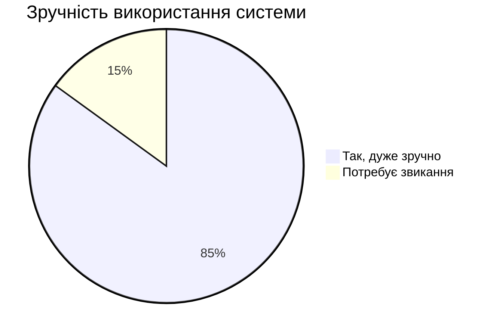

1. «Чи зручно було використовувати систему?»
   - 85% – Так, дуже зручно
   - 15% – Потребує звикання

**Рисунок 6.2 – Результати відповідей на питання "Чи точно система визначала настрій гри?"**

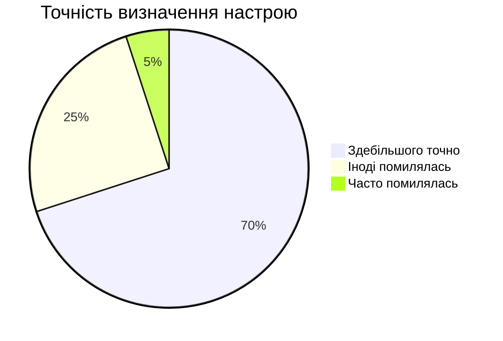

2. «Чи точно система визначала настрій гри?»
   - 70% – Так, здебільшого точно
   - 25% – Іноді помилялась
   - 5% – Часто помилялась

**Рисунок 6.3 – Результати відповідей на питання "Чи покращила система атмосферу гри?"**

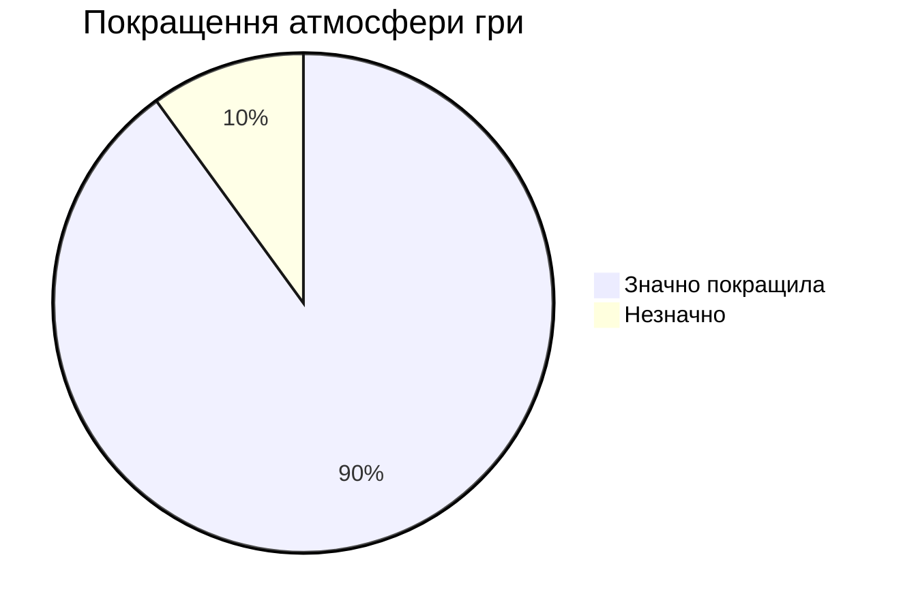

3. «Чи покращила система атмосферу гри?»
   - 90% – Так, значно покращила
   - 10% – Незначно

**Рисунок 6.4 – Результати відповідей на питання "Чи порекомендували б ви систему?"**

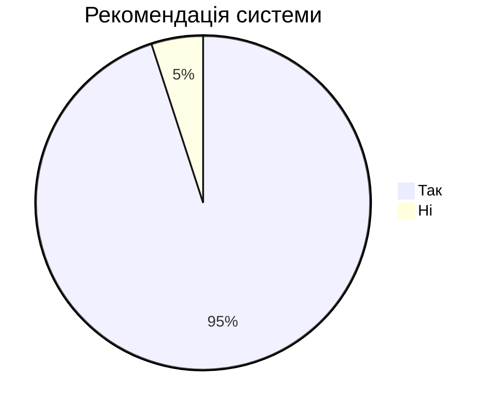

4. «Чи порекомендували б ви систему?»
   - 95% – Так

**Рисунок 6.5 – Зведена діаграма результатів опитування**

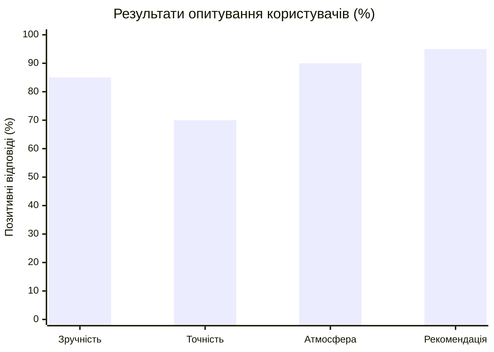

---

## ЗАГАЛЬНІ ВИСНОВКИ

В процесі розробки програмного забезпечення адаптивної музичної системи з елементами штучного інтелекту для рольових ігор було проведено аналіз предметної області, порівняння з існуючими рішеннями, визначено функціональні та нефункціональні вимоги, спроектовано архітектуру системи та реалізовано програмний продукт.

Наша система відповідає визначеним вимогам:

- Реалізовано автоматичне розпізнавання мовлення в браузері
- Інтегровано аналіз настрою на базі штучного інтелекту (Groq API + Llama 3.1)
- Створено систему динамічної зміни музики
- Реалізовано авторизацію користувачів
- Розроблено фентезійний інтерфейс

Використання штучного інтелекту для аналізу настрою виділяє нашу систему серед конкурентів, які потребують ручного управління музикою. Система дозволяє ведучим рольових ігор зосередитись на розповіді, а не на технічних аспектах музичного супроводу.

Очікується, що система буде корисною для спільноти гравців у настільні рольові ігри, забезпечуючи більш імерсивний ігровий досвід з мінімальними зусиллями.

---

## СПИСОК ВИКОРИСТАНИХ ДЖЕРЕЛ

1. React – A JavaScript library for building user interfaces. https://reactjs.org/ (дата звернення: 15.01.2026)
2. FastAPI – Modern, fast web framework for building APIs. https://fastapi.tiangolo.com/ (дата звернення: 15.01.2026)
3. Whisper – OpenAI speech recognition model. https://openai.com/research/whisper (дата звернення: 15.01.2026)
4. Groq API Documentation. https://console.groq.com/docs (дата звернення: 15.01.2026)
5. Web Audio API – MDN Web Docs. https://developer.mozilla.org/en-US/docs/Web/API/Web_Audio_API (дата звернення: 16.01.2026)
6. Zustand – State management for React. https://github.com/pmndrs/zustand (дата звернення: 16.01.2026)
7. Hugging Face Transformers.js. https://huggingface.co/docs/transformers.js (дата звернення: 16.01.2026)
8. SQLite – Self-contained SQL database engine. https://www.sqlite.org/ (дата звернення: 17.01.2026)
9. JWT – JSON Web Tokens. https://jwt.io/ (дата звернення: 17.01.2026)
10. Martin, R. C. Clean Code: A Handbook of Agile Software Craftsmanship. Prentice Hall, 2008. 464 с.
11. Syrinscape – Cinematic Sound Effects and Music. https://syrinscape.com/ (дата звернення: 10.01.2026)
12. Tabletop Audio – Ambient Sounds for Tabletop Gaming. https://tabletopaudio.com/ (дата звернення: 10.01.2026)

---

## ДОДАТОК А

## Код програми

### useAgenticLoop.js

```javascript
import { useState, useEffect, useRef, useCallback } from "react";
import useAppStore from "../store/useAppStore";
import { useAudioCapture } from "./useAudioCapture";
import {
  initWhisper,
  transcribeAudio,
  isWhisperReady,
} from "../services/whisperService";
import { analyzeMood } from "../services/moodAnalyzer";
import { audioEngine } from "../services/audioEngine";

export function useAgenticLoop() {
  const {
    isListening,
    setListening,
    setCurrentMood,
    setTranscription,
    setAnalysisResult,
    addHistoryEntry,
  } = useAppStore();

  const [isInitialized, setIsInitialized] = useState(false);
  const [error, setError] = useState(null);
  const loopRef = useRef(null);

  const { startRecording, stopRecording, getAudioBlob } = useAudioCapture();

  // Initialize Whisper on mount
  useEffect(() => {
    const init = async () => {
      try {
        await initWhisper();
        setIsInitialized(true);
      } catch (err) {
        setError("Failed to initialize speech recognition");
      }
    };
    init();
  }, []);

  const processAudioCycle = useCallback(async () => {
    if (!isListening) return;

    try {
      // Get recorded audio
      const audioBlob = await getAudioBlob();
      if (!audioBlob || audioBlob.size < 1000) return;

      // Transcribe audio
      const text = await transcribeAudio(audioBlob);
      if (!text || text.length < 3) return;

      setTranscription(text);

      // Analyze mood with AI
      const analysis = await analyzeMood(text);
      setAnalysisResult(analysis);
      setCurrentMood(analysis.mood);

      // Update music based on mood
      audioEngine.setMood(analysis.mood, analysis.intensity);

      // Add to history
      addHistoryEntry({
        timestamp: new Date().toISOString(),
        transcription: text,
        analysis,
      });
    } catch (err) {
      console.error("Processing error:", err);
    }
  }, [isListening]);

  const start = useCallback(async () => {
    if (!isInitialized) return;

    setListening(true);
    await startRecording();
    await audioEngine.initialize();
    audioEngine.playMusic();

    // Start processing loop
    loopRef.current = setInterval(processAudioCycle, 5000);
  }, [isInitialized, processAudioCycle]);

  const stop = useCallback(() => {
    setListening(false);
    stopRecording();
    audioEngine.stop();

    if (loopRef.current) {
      clearInterval(loopRef.current);
      loopRef.current = null;
    }
  }, []);

  return {
    isInitialized,
    isListening,
    error,
    start,
    stop,
  };
}
```

### whisperService.js

```javascript
import { pipeline } from "@huggingface/transformers";

let whisperPipeline = null;

export async function initWhisper() {
  if (whisperPipeline) return;

  console.log("Initializing Whisper...");
  whisperPipeline = await pipeline(
    "automatic-speech-recognition",
    "Xenova/whisper-tiny.en",
    { device: "webgpu" },
  );
  console.log("Whisper ready");
}

export function isWhisperReady() {
  return whisperPipeline !== null;
}

export async function transcribeAudio(audioBlob) {
  if (!whisperPipeline) {
    throw new Error("Whisper not initialized");
  }

  const audioData = await decodeAudioBlob(audioBlob);
  const result = await whisperPipeline(audioData);

  return result.text.trim();
}

async function decodeAudioBlob(blob) {
  const arrayBuffer = await blob.arrayBuffer();
  const audioContext = new AudioContext({ sampleRate: 16000 });
  const audioBuffer = await audioContext.decodeAudioData(arrayBuffer);

  return audioBuffer.getChannelData(0);
}
```

### moodAnalyzer.js

```javascript
const API_BASE = "http://localhost:3000/api";

export async function analyzeMood(text) {
  const response = await fetch(`${API_BASE}/analyze-mood`, {
    method: "POST",
    headers: { "Content-Type": "application/json" },
    body: JSON.stringify({ text }),
  });

  if (!response.ok) {
    throw new Error("Analysis failed");
  }

  return response.json();
}
```

### Backend: routers/mood.py

```python
from fastapi import APIRouter, HTTPException
from pydantic import BaseModel
from groq import Groq
from ..config import settings

router = APIRouter()

class MoodRequest(BaseModel):
    text: str

class MoodResponse(BaseModel):
    mood: str
    intensity: int
    environment: str
    reasoning: str

@router.post("/analyze-mood", response_model=MoodResponse)
async def analyze_mood(request: MoodRequest):
    client = Groq(api_key=settings.groq_api_key)

    prompt = f"""Analyze this RPG game conversation and determine:
    1. mood: one of [calm, tense, battle, mystery, celebration, sad]
    2. intensity: 1-10
    3. environment: one of [tavern, forest, dungeon, castle, town, wilderness]
    4. reasoning: brief explanation

    Text: "{request.text}"

    Respond in JSON format only."""

    response = client.chat.completions.create(
        model="llama-3.1-8b-instant",
        messages=[{"role": "user", "content": prompt}]
    )

    result = parse_json(response.choices[0].message.content)
    return MoodResponse(**result)
```

### Backend: routers/auth.py

```python
from fastapi import APIRouter, HTTPException, status, Depends
from pydantic import BaseModel, EmailStr
from ..auth import get_password_hash, verify_password, create_access_token, get_current_user
from ..database import get_user_by_email, create_user

router = APIRouter()

class UserRegister(BaseModel):
    email: EmailStr
    username: str
    password: str

class UserLogin(BaseModel):
    email: EmailStr
    password: str

class TokenResponse(BaseModel):
    access_token: str
    token_type: str

@router.post("/register", response_model=TokenResponse, status_code=201)
async def register(data: UserRegister):
    existing = await get_user_by_email(data.email)
    if existing:
        raise HTTPException(status_code=400, detail="Email already registered")

    hashed_password = get_password_hash(data.password)
    user = await create_user(data.email, data.username, hashed_password)

    token = create_access_token({"sub": str(user["id"]), "email": user["email"]})
    return TokenResponse(access_token=token, token_type="bearer")

@router.post("/login", response_model=TokenResponse)
async def login(data: UserLogin):
    user = await get_user_by_email(data.email)
    if not user or not verify_password(data.password, user["hashed_password"]):
        raise HTTPException(status_code=401, detail="Invalid credentials")

    token = create_access_token({"sub": str(user["id"]), "email": user["email"]})
    return TokenResponse(access_token=token, token_type="bearer")
```

### AuthPage.jsx

```jsx
import { useState } from "react";
import useAppStore from "../store/useAppStore";
import { register, login } from "../services/authService";

export default function AuthPage() {
  const [isLogin, setIsLogin] = useState(true);
  const [email, setEmail] = useState("");
  const [username, setUsername] = useState("");
  const [password, setPassword] = useState("");
  const [confirmPassword, setConfirmPassword] = useState("");
  const [error, setError] = useState("");
  const [loading, setLoading] = useState(false);

  const { setUser } = useAppStore();

  const handleSubmit = async (e) => {
    e.preventDefault();
    setError("");
    setLoading(true);

    try {
      if (isLogin) {
        const user = await login(email, password);
        setUser(user);
      } else {
        if (password !== confirmPassword) {
          setError("Passwords do not match");
          return;
        }
        const user = await register(email, username, password);
        setUser(user);
      }
    } catch (err) {
      setError(err.message);
    } finally {
      setLoading(false);
    }
  };

  return (
    <div className="auth-container fantasy-theme">
      <div className="auth-card">
        <h1 className="fantasy-title">Adaptive OST</h1>
        <p className="subtitle">AI-Powered Music for Your Adventures</p>

        <form onSubmit={handleSubmit}>
          <input
            type="email"
            placeholder="Email"
            value={email}
            onChange={(e) => setEmail(e.target.value)}
            required
          />

          {!isLogin && (
            <input
              type="text"
              placeholder="Username"
              value={username}
              onChange={(e) => setUsername(e.target.value)}
              required
            />
          )}

          <input
            type="password"
            placeholder="Password"
            value={password}
            onChange={(e) => setPassword(e.target.value)}
            required
          />

          {!isLogin && (
            <input
              type="password"
              placeholder="Confirm Password"
              value={confirmPassword}
              onChange={(e) => setConfirmPassword(e.target.value)}
              required
            />
          )}

          {error && <p className="error">{error}</p>}

          <button type="submit" disabled={loading}>
            {loading
              ? "Loading..."
              : isLogin
                ? "Enter the Realm"
                : "Begin Your Quest"}
          </button>
        </form>

        <p className="switch-mode">
          {isLogin ? "Don't have an account? " : "Already have an account? "}
          <button onClick={() => setIsLogin(!isLogin)}>
            {isLogin ? "Create account" : "Sign in"}
          </button>
        </p>
      </div>
    </div>
  );
}
```
